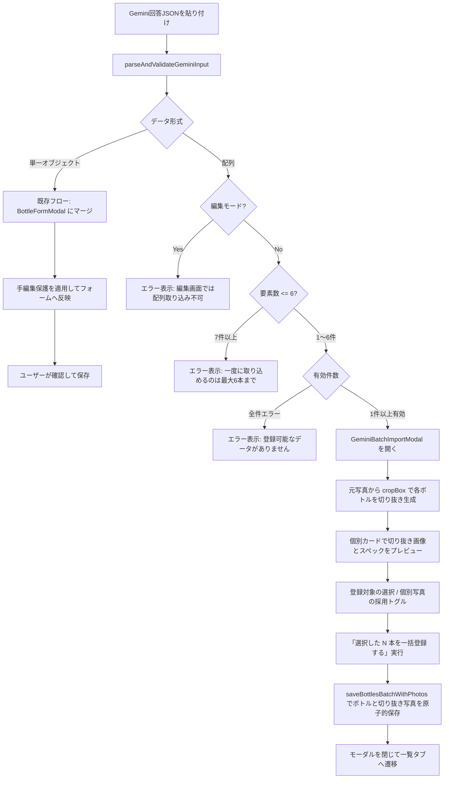
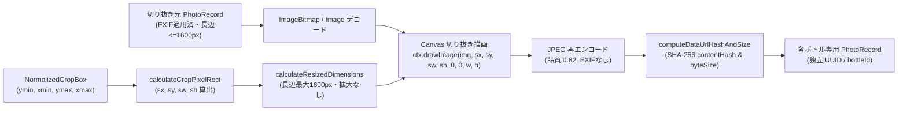
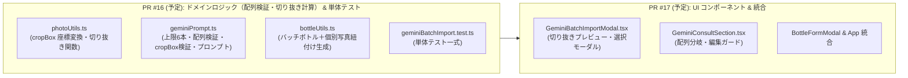

# Gemini 相談結果の配列一括取り込み 機能詳細設計（改訂版）

作成日: 2026-11-11（改訂: ユーザー指示2点を反映）
作成者: Argon (Antigravity)
ステータス: 確定（ユーザー承認済）

---

## 1. 背景と目的

本番環境（`sake-collection-cs2.pages.dev`）において、ユーザーが複数本のお酒（例: スパークリングワイン4本セット）の写真を Gemini に相談した際、Gemini は各ボトルの情報を1つの JSON 配列 `[ { ... }, { ... } ]` として出力しました。
現在の取り込み処理（`parseAndValidateGeminiJson`）は単一オブジェクト `{ ... }` 専用で配列を弾くため、登録できませんでした。

まとめ買いやセット購入した複数銘柄（最大6本）を一度に相談・登録したいという自然なユースケースに応えるため、**集合写真からのボトル個別切り抜き（`cropBox`）を伴う JSON 配列の一括検証・選択・登録機能** を追加します。

---

## 2. 完了条件と不変条件

### 完了条件
1. **配列の個別検証・写真切り抜き・一括登録**:
   - 配列形式の JSON（最大6銘柄）を取り込んだ際、各要素が個別に二段階検証（エラー／警告）される。
   - 集合写真と各要素の切り抜き範囲（`cropBox`）からボトルごとの個別写真が切り抜かれ、確認モーダル上でプレビュー表示される。
   - 登録可能な銘柄を一覧で確認・選択（全選択／個別除外）し、一括登録できる。
   - 一部の要素にエラーが含まれる場合でも、正常な要素の登録を妨げず、エラー要素のみ除外・理由を明示する。
2. **単一オブジェクトの従来フローの完全維持**:
   - 1銘柄の JSON オブジェクト `{ ... }` を取り込んだ場合は、従来どおり現在の `BottleFormModal` へのフィールドマージと手編集項目（`userEditedFields`）の保護が一切変わらず機能する。
3. **標準検証コマンドの exit 0**:
   - `npm run verify`（データ整合性・型検査・Lint・テスト・ビルドの5工程）が exit 0 を維持する。

### 不変条件
- **1本＝1レコード、銘柄まとめ表示のデータモデル原則**:
  - 配列から登録される各ボトルは、それぞれ独立した UUID、タイムスタンプ、`deleted: false` を持つ個別レコードとして保存される。
- **同一銘柄の本数まとめ登録の上限（10本）は不変**:
  - 既存の `createBottlesBatch`（同一銘柄の複数本一括登録）の上限 10本 は別機能として変更しない。本設計で上限 6本 とするのは Gemini 配列一括取り込みのみ。
- **バックアップ取り込みとの境界分離**:
  - バックアップ JSON の全件原子的取り込み（`backup.ts`）の厳格なスキーマ検証は不変。
- **手編集項目の保護と単一オブジェクト検証ルール**:
  - `mergeGeminiPayloadIntoBottle` の保護ルール、および必須項目・数値型・不要属性除外などの二段階検証ルールは不変。

---

## 3. 主要設計決定事項

### 3.1 体験の流れ (UX Flow)



1. **入力検出と分岐**:
   - `GeminiConsultSection` の取り込みボタン押下時、入力文字列を解析して「単一オブジェクト」か「配列」かを自動判別します。
2. **編集モードでの配列取り込みの禁止**:
   - 既存ボトルの編集時（`isEditing: true`）に配列を取り込もうとした場合は、エラーメッセージ `「複数銘柄の配列データは新規登録時のみ取り込めます。既存ボトルの編集では単一のお酒データを取り込んでください。」` を赤色で表示します。
3. **配列取り込み確認モーダル（`GeminiBatchImportModal`）の起動**:
   - 新規登録時かつ配列が1〜6件で1件以上の有効要素を含む場合、専用の確認モーダル `GeminiBatchImportModal` を開きます。
4. **一部不正要素の扱い（部分許容）**:
   - **有効な銘柄**: チェックボックス付きカード（デフォルト選択）として表示。切り抜き画像プレビュー、スペック、相場目安、解説、警告内容を表示。
   - **無効な銘柄**: 赤枠の「登録不可」カードとして表示。エラー理由（例: 「2本目: 必須項目『名前（銘柄名）』が空欄です」）を明示し、選択不可とします。

---

### 3.2 写真の扱い — `cropBox` による切り抜きと分割保存（改訂）

集合写真を全ボトルへそのまま複製する方式は採らず、**Gemini が返した切り抜き範囲（`cropBox`）に従って集合写真から各ボトルを切り抜き、ボトル専用の `PhotoRecord` として分割保存する方式** とします。

#### (1) `cropBox` の座標系定義
Gemini の空間認識（Spatial Grounding）が最も高い精度を発揮する **0〜1000 の正規化座標系（左上原点 `(0, 0)`、右下 `(1000, 1000)`）** を標準とします。

```json
"cropBox": {
  "ymin": 80,
  "xmin": 120,
  "ymax": 920,
  "xmax": 310
}
```

- **検証と正規化ルール (`validateAndNormalizeCropBox`)**:
  - オブジェクト形式 `{ ymin, xmin, ymax, xmax }` を標準として受け付けます。また、Gemini が `[ymin, xmin, ymax, xmax]` の4要素配列や `0.0〜1.0` の比率（全値が `<= 1.0` かつ正）で出力した場合も、パーサー側で `0〜1000` の `{ ymin, xmin, ymax, xmax }` に自動正規化して吸収します。
  - 有効条件:
    - 4値すべてが有限の数値であり、`0 <= ymin < ymax <= 1000` かつ `0 <= xmin < xmax <= 1000` を満たすこと（端数のわずかなはみ出しは `0..1000` にクランプ）。
    - 幅・高さが画像の一定比率以上（`xmax - xmin >= 30` かつ `ymax - ymin >= 30`、すなわち縦横とも元画像の3%以上）あること。極小の異常矩形は不正座標として扱います。

#### (2) 切り抜き情報がない要素・座標が不正な要素の扱い
- **`cropBox` が `null` / 未指定の場合**:
  - そのボトルは **「写真なし」（`photoIds: []`, `primaryPhotoId: null`）** として正常に取り込みます（警告なし）。
- **`cropBox` の座標が不正な場合（型不正・逆転・範囲外・極小矩形）**:
  - ボトル自体の登録は止めず、**「写真なし」にフォールバック** した上で、その要素に警告 `「切り抜き範囲（cropBox）の座標が不正なため、写真なしで取り込みます。」` を付与します。
- **モーダル上での個別写真除外**:
  - 切り抜きが成功したボトルについても、確認モーダルの各カードに `[x] この切り抜き写真を使う` のチェックを設け、もし切り抜き位置が気に入らない場合はチェックを外して「写真なし」で登録（後から撮り直し）できるようにします。

#### (3) 添付写真が複数枚ある場合の切り抜き元写真の決め方
- **既定の切り抜き元写真**:
  - `BottleFormModal` の写真管理セクションで設定されている **「代表写真」（`primaryPhotoId`、未指定時は1枚目の写真 `draftPhotos[0]`）** を切り抜き元（集合写真）として使用します。
- **複数枚添付時の切り替え UI**:
  - 添付写真が2枚以上ある場合は、`GeminiBatchImportModal` の上部に **「切り抜き元の集合写真を選択」** サムネイルバーを表示し、ユーザーが別の添付写真をタップすると即座にその写真から全ボトルを再切り抜きしてプレビューを更新します。
- **添付写真が0枚の場合**:
  - JSON 内に `cropBox` が含まれていても切り抜きは行わず、全ボトルを「写真なし」として扱います。

#### (4) 切り抜き後の画像処理パイプライン
既存の `src/domain/photoUtils.ts` の画像処理・ハッシュ算出パイプラインと完全に統合します。



1. **ピクセル矩形算出 (`calculateCropPixelRect`)**:
   - 元画像の寸法 `(origW, origH)` と `cropBox (0..1000)` から、切り抜き開始位置 `(sx, sy)` と幅・高さ `(sw, sh)` を整数ピクセルで算出する純粋関数です。
2. **リサイズ寸法計算 (`calculateResizedDimensions`)**:
   - `(sw, sh)` に対して既存の `calculateResizedDimensions(sw, sh, 1600)` を適用します（元画像がすでに長辺 1600px 以下のため拡大はされず、切り抜き領域の解像度がそのまま維持されます）。
3. **Canvas 描画と JPEG 0.82 再エンコード**:
   - 切り抜き領域を新しい Canvas に描画し、`image/jpeg`（品質 `0.82`）の Data URL を生成します。
4. **SHA-256 ハッシュとサイズ算出 (`computeDataUrlHashAndSize`)**:
   - PR #9 で整備した `computeSha256`（Web Crypto / 純粋 JS フォールバック対応）により、切り抜き後の画像固有の `contentHash` と `byteSize` を算出します。
5. **元集合写真の破棄**:
   - 一括登録完了時、各ボトルには切り抜かれた個別の `PhotoRecord` のみが紐付いて IndexedDB（`saveBottlesBatchWithPhotos`）に保存されます。`BottleFormModal` 上で一時保持されていた元の集合写真（`draftPhotos`）はどのボトルからも参照されないため DB には保存されず、不要なデータが残らない原則（AGENTS.md §6）を厳守します。

---

### 3.3 重複警告 (Duplicate Warnings)

1. **既存コレクションとの重複**:
   - 各要素について `findDuplicateBottles(allBottles, item)` を実行し、既存ボトルと同名・同種類がある場合はアンバー色で警告を表示します。
     > `⚠️ 既存データ重複: 『{name}』は既に {total}本 登録されています（家にある酒: {inv}本 / 飲んだ記録: {fin}本 / 手放した酒: {disposed}本）`
2. **取り込み配列内部での同一銘柄重複**:
   - セット内に同じ銘柄が複数本含まれている場合（`normalizeSakeName` ＋ `category` が一致）、該当カードに情報バッジを表示します。
     > `ℹ️ セット内重複: この取り込みデータ内に同名銘柄が {count} 件含まれています（それぞれ独立したボトルとして登録されます）`

---

### 3.4 件数の上限 — 最大6本（改訂）

- **配列一括取り込みの上限**: **最大6本**（`MAX_GEMINI_BATCH_SIZE = 6`）。
- **超過時の挙動**:
  - 配列の要素数が 7件 以上の場合は、全体をエラーとして弾きます。
  - エラー文: `「一度に取り込めるのは最大6本までです（検出件数: {count}本）。6本以内に分割して取り込んでください。」`
- **既存機能との区別**:
  - `BottleFormModal` 内の同一銘柄本数指定（`createBottlesBatch`）の上限 10本 は変更しません。

---

### 3.5 プロンプトの改定 (Prompt Update)

`src/domain/geminiPrompt.ts` の `buildGeminiConsultationPrompt` に、複数本（最大6本）が写っている場合の JSON 配列出力指示と `cropBox` の指定方法を追加します。

```text
【複数のお酒が写っている場合（最大6本まで）】
写真に複数のお酒が写っている場合は、左（または上）に写っているお酒から順に、上記フォーマットのオブジェクトに「cropBox」を追加したJSON配列（[ { ... }, { ... } ]、最大6本まで）として出力してください。
- 各要素には、1枚目の全体写真におけるそのボトル1本分の切り抜き範囲を「cropBox」として必ず含めてください。
- 座標は画像全体の左上を (0, 0)、右下を (1000, 1000) とする 0〜1000 の整数で、ボトル全体（キャップから底まで）が収まる矩形を指定してください:
  "cropBox": { "ymin": 上端, "xmin": 左端, "ymax": 下端, "xmax": 右端 }
- 写真にボトル本体が写っていない場合や1本のみの相談の場合は、"cropBox" は省略または null にしてください。
```

---

## 4. 影響ファイルと実装詳細

### 4.1 ドメイン層

#### [MODIFY] `src/domain/photoUtils.ts`
- `NormalizedCropBox`, `CropPixelRect` 型定義の追加。
- `calculateCropPixelRect(origW, origH, cropBox)`:
  - `0..1000` の正規化座標からピクセル単位の切り抜き矩形 `{ sx, sy, sw, sh }` を算出する純粋関数。
- `cropPhotoRecordToNewPhotoRecord(sourcePhoto, cropBox, targetBottleId, options)`:
  - 元写真の `dataUrl` から指定矩形を切り抜き、JPEG 0.82 再エンコード・SHA-256 ハッシュ算出を行って新しい `PhotoRecord` を生成する非同期関数。

#### [MODIFY] `src/domain/geminiPrompt.ts`
- `MAX_GEMINI_BATCH_SIZE = 6` 定数の定義。
- `GeminiImportPayload` に `cropBox?: NormalizedCropBox | null` を追加（単一オブジェクト時は `null` または省略可）。
- `validateAndNormalizeCropBox(rawCropBox)`:
  - `{ ymin, xmin, ymax, xmax }` または `[ymin, xmin, ymax, xmax]` を検証・正規化し、不正時は警告とともに `null` にフォールバックする純粋関数。
- `extractJsonFromText`:
  - コードブロックなしでも先頭の `[` から末尾の `]` までの JSON 配列抽出に対応。
- `parseAndValidateGeminiBatchJson` / `parseAndValidateGeminiInput`:
  - 単一オブジェクトと配列（1〜6件）の判別、要素ごとの二段階検証と結果返却。
- `buildGeminiConsultationPrompt`:
  - 複数本（最大6本）の配列出力と `cropBox`（0〜1000座標）の指示を追加。

#### [MODIFY] `src/domain/bottleUtils.ts`
- `createBottlesFromGeminiBatch`:
  - 選択された `GeminiImportPayload[]` と、各要素に対応する切り抜き済み `PhotoRecord`（または `null`）を受け取り、独立した `BottleRecord[]` と保存用 `PhotoRecord[]` を生成する純粋関数。

---

### 4.2 UI 層

#### [NEW] `src/components/GeminiBatchImportModal.tsx`
- モバイル画面高さ固定（`h-full h-dvh max-h-dvh sm:h-auto sm:max-h-[92vh]`、PR #15 準拠）。
- 添付写真が複数枚ある場合の「切り抜き元の写真」選択バー（デフォルトは代表写真）。
- 各ボトルの切り抜き処理実行とプレビュー表示（切り抜き画像サムネイル＋`[x] この切り抜き写真を使う` チェック、切り抜き情報がない場合は「写真なし」表示）。
- 各カードの登録対象チェックボックス、スペック、解説プレビュー、相場目安、2系統の重複警告（既存重複・セット内重複）、要素別警告の表示。
- 無効要素の赤枠エラー理由表示。
- フッターアクション（「キャンセル」「選択した N 本を一括登録する」）。

#### [MODIFY] `src/components/GeminiConsultSection.tsx`
- `isEditing?: boolean` と `onImportBatch?: (batchResult: GeminiBatchValidationResult) => void` を追加。
- 配列入力時、編集モードならエラー表示、新規登録モードなら `onImportBatch` を呼び出す。

#### [MODIFY] `src/components/BottleFormModal.tsx` & `src/App.tsx`
- `BottleFormModal` で `GeminiBatchImportModal` を開閉し、一括登録確定時に `saveBottlesBatch`（`saveBottlesBatchWithPhotos`）を呼び出してボトル群と切り抜き写真群を単一トランザクションで保存、一覧画面へ遷移。

---

## 5. PR 分割計画



### PR 1: ドメインロジックと単体テスト（ブランチ: `feat/gemini-batch-import-domain`）
- **対象ファイル**:
  - `src/domain/photoUtils.ts`
  - `src/domain/geminiPrompt.ts`
  - `src/domain/bottleUtils.ts`
  - `tests/geminiBatchImport.test.ts`
- **完了条件**: `npm run verify` exit 0

### PR 2: UI コンポーネントと統合（ブランチ: `feat/gemini-batch-import-ui`）
- **対象ファイル**:
  - `src/components/GeminiBatchImportModal.tsx`
  - `src/components/GeminiConsultSection.tsx`
  - `src/components/BottleFormModal.tsx`
  - `src/App.tsx`
- **完了条件**: `npm run verify` exit 0

---

## 6. テスト計画（恒常ロジックテスト）

`tests/geminiBatchImport.test.ts` にて以下の恒常テストを実装します。

1. **配列 JSON 抽出 (`extractJsonFromText`)**:
   - コードブロック有無、前後テキスト混在時の JSON 配列 `[ ... ]` 抽出。
2. **上限6本の境界値検証 (`parseAndValidateGeminiBatchJson`)**:
   - 1〜6件の配列が受理されること。
   - 7件以上の配列が `「一度に取り込めるのは最大6本までです」` のエラーで拒否されること。
   - 空配列 `[]` がエラーで拒否されること。
3. **`cropBox` 検証と正規化 (`validateAndNormalizeCropBox`)**:
   - 正常な `{ ymin, xmin, ymax, xmax }`（0〜1000）が保持されること。
   - 配列形式 `[ymin, xmin, ymax, xmax]` や `0..1` 小数形式が `0..1000` に正規化されること。
   - `cropBox` 未指定・`null` の場合は警告なしで `cropBox: null`（写真なし）となること。
   - 座標逆転（`xmin >= xmax`）、範囲外、極小矩形（3%未満）などの不正座標は、ボトル自体をエラーにせず警告付きで `cropBox: null`（写真なし）にフォールバックすること。
4. **切り抜きピクセル矩形計算 (`calculateCropPixelRect`) & Canvas 切り抜き (`cropPhotoRecordToNewPhotoRecord`)**:
   - 元画像（例: 1600×1200）と `cropBox` から正確なピクセル座標 `(sx, sy, sw, sh)` が計算されること。
   - モック Canvas 環境で切り抜き後の `PhotoRecord` が生成され、元写真とは異なる新しい UUID・`bottleId`・SHA-256 `contentHash` を持つこと。
5. **部分許容とバッチボトル生成 (`createBottlesFromGeminiBatch`)**:
   - 4本中1本が名前欠落エラー、1本が `cropBox` 不正警告の場合、有効な3本が抽出され、うち2本は切り抜き写真付き・1本は写真なしの独立した `BottleRecord` として生成されること。
6. **単一オブジェクトおよび `createBottlesBatch(上限10本)` の非破壊検証**:
   - 単一オブジェクト取り込み・手編集保護・同一銘柄10本一括生成の既存動作が不変であること。
