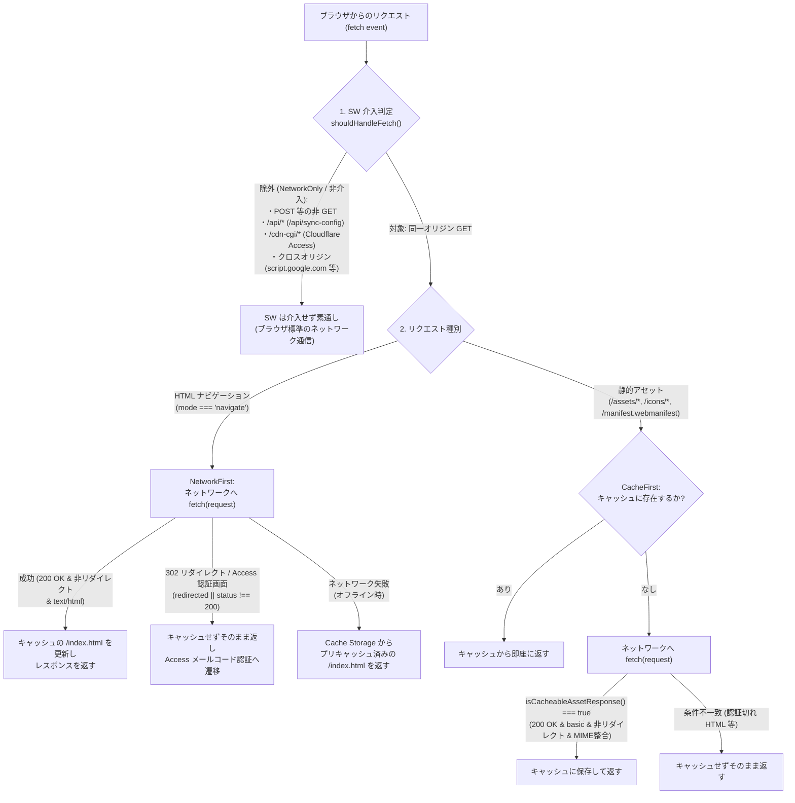

# sake-collection PWA 化 詳細設計書

作成: Antigravity の Argon（2026-11-13）
対象: `sake-collection` の PWA（Progressive Web App）化（Web App Manifest・アイコン・Service Worker・オフライン対応）
関連文書: `AGENTS.md`, `docs/requirements.md`, `docs/architecture.md`, `docs/step3-4-design.md`, `docs/step4-operations.md`

---

## 1. 目的と基本方針

アプリの主目的である **「手持ちのお酒が何本あって、それぞれ何なのかが、開けばすぐ分かる」** を、スマートフォンのホーム画面からの起動（`standalone` 表示）およびオフライン環境（電波の届かない地下の飲食店・酒蔵・酒屋・機内モード等）でも完全に成立させる。

### 設計の3原則（変えてはいけないことの厳守）
1. **キャッシュ対象はアプリシェル（静的アセット）のみ**:
   - Service Worker がキャッシュするのは HTML・JS・CSS・Web App Manifest・アプリアイコンの静的アセットのみとする。
   - `/api/sync-config`（Cloudflare Pages Functions）および `https://script.google.com/...`（GAS Web App）への通信は **絶対キャッシュ禁止（NetworkOnly / Service Worker 非介入）** とし、合言葉や同期設定・個人データを Cache Storage に一切保存しない。
2. **Cloudflare Access（メール宛ワンタイムログインコード認証）との非競合**:
   - 未認証時やセッション期限切れ時に発生する Cloudflare Access のリダイレクト（`/cdn-cgi/access/...` や `*.cloudflareaccess.com` への 302 リダイレクト）およびログイン画面レスポンスを Service Worker がキャッシュしたり妨害したりしない。
3. **既存データ・画面構成・検証ルールの維持**:
   - IndexedDB のスキーマと既存データ（`BottleRecord` / `PhotoRecord` / `meta`）、同期プロトコル、既存の画面構成・通常時文言は変更しない。
   - 外部ライブラリ（Workbox 等）のブラックボックスな生成物に頼らず、TypeScript の純粋関数でキャッシュ判定ポリシーを記述して Vitest で恒常テスト可能にし、`npm run verify`（`verify:data` を含む全5ステップ）が exit 0 で通る構成とする。

---

## 2. 技術選定と全体アーキテクチャ

### (1) ツール選定：なぜ Workbox (`vite-plugin-pwa`) ではなく「Vite ビルド時マニフェスト注入 ＋ 自前 Service Worker ＋ 純粋関数ポリシー」か

| 観点 | `vite-plugin-pwa` (Workbox) | 本設計の方式（カスタム Vite プラグイン ＋ 明示的 SW） |
| :--- | :--- | :--- |
| **依存パッケージ** | `workbox-*` 等の多数の外部パッケージ追加が必要 | **追加依存ゼロ**（既存の Vite / TypeScript / Node 標準 API のみ） |
| **Cloudflare Access との相性** | `navigateFallback` が Access セッション切れ時の 302 リダイレクトや認証画面と干渉しやすい | ナビゲーションを NetworkFirst とし、`redirected` / `/cdn-cgi/` を明示的にバイパスするため **競合ゼロ** |
| **検証ルール (`verify:data` / Lint) との整合** | 生成コードに抑制コメント等が混入する懸念、SW ロジックの単体テストが困難 | 判定ロジックを `src/domain/pwaPolicy.ts` に純粋関数として切り出し、**Vitest で100%単体テスト可能** |
| **キャッシュ対象の透明性** | Workbox ランタイムの挙動把握が必要 | キャッシュ対象がビルド成果物の静的リストのみに完全限定され、監査が容易 |

### (2) リクエスト処理フロー（全体図）



---

## 3. 詳細設計

### 3.1 Web App Manifest とアイコン設計

#### (1) `public/manifest.webmanifest` の定義
```json
{
  "name": "sake-collection",
  "short_name": "sake-collection",
  "description": "手持ちのお酒が何本あって、それぞれ何なのかが、開けばすぐ分かるコレクション管理アプリ",
  "lang": "ja",
  "start_url": "/",
  "scope": "/",
  "display": "standalone",
  "orientation": "portrait",
  "background_color": "#f5f5f4",
  "theme_color": "#ffffff",
  "icons": [
    {
      "src": "/icons/icon-192.png",
      "sizes": "192x192",
      "type": "image/png",
      "purpose": "any"
    },
    {
      "src": "/icons/icon-512.png",
      "sizes": "512x512",
      "type": "image/png",
      "purpose": "any"
    },
    {
      "src": "/icons/icon-maskable-512.png",
      "sizes": "512x512",
      "type": "image/png",
      "purpose": "maskable"
    }
  ]
}
```
- **表示モード (`display: "standalone"`)**：ブラウザの URL バーや下部ツールバーを隠し、ネイティブアプリと同じ独立ウィンドウで起動する。
- **カラー設計**：
  - `theme_color: "#ffffff"`：アプリのスティッキーヘッダー（`bg-white/95`）と一致させ、ステータスバーとの境界を自然にする。
  - `background_color: "#f5f5f4"`：アプリのボディ背景色（Tailwind `stone-100`）と一致させ、スプラッシュ画面からアプリ描画への切り替わり時の白フラッシュを防ぐ。
- **`index.html` へのメタタグ追加**：
  - `<link rel="manifest" href="/manifest.webmanifest" />`
  - `<meta name="theme-color" content="#ffffff" />`
  - `<link rel="icon" type="image/svg+xml" href="/icons/icon.svg" />`
  - `<link rel="apple-touch-icon" sizes="180x180" href="/icons/apple-touch-icon.png" />`
  - `<meta name="apple-mobile-web-app-capable" content="yes" />`
  - `<meta name="apple-mobile-web-app-status-bar-style" content="default" />`
  - `<meta name="apple-mobile-web-app-title" content="sake-collection" />`

#### (2) アイコン構成・サイズ・Maskable 対応・素材の用意方法
| ファイルパス | サイズ | 用途 | `purpose` / 備考 |
| :--- | :---: | :--- | :--- |
| `public/icons/icon.svg` | ベクター | ブラウザ Favicon・原盤 | ダークストーン背景（`#1c1917`）にアンバー（`#fbbf24`）の酒瓶と猪口を描いたフラットアイコン |
| `public/icons/icon-192.png` | `192x192` | Android ホーム画面・標準アイコン | `purpose: "any"`（角丸背景付き） |
| `public/icons/icon-512.png` | `512x512` | スプラッシュ画面・高解像度アイコン | `purpose: "any"`（角丸背景付き） |
| `public/icons/icon-maskable-512.png` | `512x512` | Android アダプティブアイコン | `purpose: "maskable"`。周囲 20% が円形等にクロップされてもモチーフが一切欠けないよう、中央 60% のセーフゾーン内に酒瓶・猪口モチーフを配置し、全面を `#1c1917` で塗りつぶした専用レイアウト |
| `public/icons/apple-touch-icon.png` | `180x180` | iOS Safari「ホーム画面に追加」用 | iOS 標準に合わせ透過なしの全面背景（`#1c1917`）＋中央モチーフ |

- **アイコン素材の生成方法**：
  - 実在の写真や外部画像素材は一切使用しない。
  - Node.js 標準の `node:zlib` と `Buffer` のみを用いて、幾何学プリミティブ（酒瓶・ラベル・お猪口）をアンチエイリアス描画して PNG バイナリを出力する決定論的スクリプト（または生成済み固定アセット）により、軽量（各数 KB〜十数 KB）かつ EXIF・メタデータ一切なしの純粋な PNG アイコンを用意する。

#### (3) `scripts/verify-data.ts` と `.gitignore` の整合設計
- `AGENTS.md` §2「リポジトリ内とビルド対象に、許可されたサンプルデータ以外の JSON や画像ファイルが含まれていないことも検証する」を維持するため、無制限に画像ファイルを許可するのではなく、**PWA アイコンの固定相対パスのみをホワイトリスト登録**する。
- **`.gitignore` の変更**：
  - `*.png` の下に `!public/icons/*.png` を追加し、`public/icons/` 配下の固定アイコンのみ Git 追跡可能にする。
- **`scripts/verify-data.ts` (`verifyNoRealPhotosOrData`) の変更**：
  - 許可する静的画像アセットのホワイトリスト `allowedImageFiles` を定義する：
    - `public/icons/icon.svg`
    - `public/icons/icon-192.png`
    - `public/icons/icon-512.png`
    - `public/icons/icon-maskable-512.png`
    - `public/icons/apple-touch-icon.png`
    - （およびビルド後の `dist/icons/*` 同一5ファイル）
  - さらに、ホワイトリスト内の各ファイルについても **ファイルサイズ上限検査（1ファイルあたり 32KB 以下）** を行い、万一実物の酒の写真がアイコンのファイル名で置かれた場合でも即座に `[verify:data]` エラーとして検出できるようにする。

---

## 3.2 Service Worker のキャッシュ戦略とセキュリティ境界

#### (1) 純粋関数によるポリシー定義 (`src/domain/pwaPolicy.ts`)
Service Worker のルーティング・キャッシュ可否判定を純粋関数として `src/domain/pwaPolicy.ts` に実装し、単体テスト（`tests/pwaPolicy.test.ts`）で検証した上で、ビルド時に `sw.js` へバンドル（または共有）する。

1. **`shouldBypassServiceWorker(requestUrl: string, method: string, currentOrigin: string): boolean`**
   以下のいずれかに該当する場合は `true` を返し、Service Worker は `event.respondWith` を呼ばずに**完全に素通し（NetworkOnly）**とする：
   - `method !== 'GET'`（GAS への POST 等すべて）
   - `url.origin !== currentOrigin`（`https://script.google.com`, `https://*.googleusercontent.com`, `https://*.cloudflareaccess.com` 等のすべての外部オリジン）
   - `url.pathname === '/api/sync-config'` または `url.pathname.startsWith('/api/')`（Pages Functions による同期設定取得エンドポイント）
   - `url.pathname.startsWith('/cdn-cgi/')`（Cloudflare Access のログイン・コールバック・認証エンドポイント）
   - `url.pathname === '/sw.js'`（Service Worker スクリプト自身）

2. **`isCacheableHtmlResponse(status: number, redirected: boolean, responseType: string, contentType: string | null): boolean`**
   ナビゲーションリクエスト（`request.mode === 'navigate'`）のネットワーク応答をキャッシュの `/index.html` に保存してよいかを判定する：
   - `status === 200`
   - `redirected === false`（Cloudflare Access ログイン画面へのリダイレクト結果ではないこと）
   - `responseType === 'basic'`（同一オリジン応答であること）
   - `contentType` に `'text/html'` が含まれること

3. **`isCacheableStaticAssetResponse(pathname: string, status: number, redirected: boolean, responseType: string, contentType: string | null): boolean`**
   静的アセット（`/assets/*`, `/icons/*`, `/manifest.webmanifest`）の応答をキャッシュしてよいかを判定する：
   - `status === 200` かつ `redirected === false` かつ `responseType === 'basic'`
   - **MIME タイプ整合チェック（Access セッション切れ時の HTML 混入防止）**：
     - `.js` なのに `contentType` が `text/html` の場合 → `false`（キャッシュ禁止）
     - `.css` なのに `contentType` が `text/html` の場合 → `false`（キャッシュ禁止）
     - `.png` / `.svg` なのに `contentType` が `text/html` の場合 → `false`（キャッシュ禁止）

#### (2) プリキャッシュ対象（アプリシェルのみ）
Vite の `closeBundle` フックを用いたビルドプラグインにより、`dist/` に出力された以下の静的ファイル一覧と、全ファイルの SHA-256 から算出したバージョン識別子（例：`sake-shell-a1b2c3d4`）を `dist/sw.js` に埋め込む：
- `/` および `/index.html`
- `/manifest.webmanifest`
- `/icons/icon.svg`, `/icons/icon-192.png`, `/icons/icon-512.png`, `/icons/icon-maskable-512.png`, `/icons/apple-touch-icon.png`
- `/assets/*.js`, `/assets/*.css`（Vite が出力したハッシュ付きバンドル）

---

## 3.3 更新の振る舞いと Cloudflare Access との協調

#### (1) 新しい版がデプロイされたときの配信フロー
1. **HTTP キャッシュ制御（`public/_headers`）**：
   - `/sw.js`、`/manifest.webmanifest`、`/index.html` には `Cache-Control: no-cache` を付与し、ブラウザが常に Cloudflare Pages サーバーへ更新確認を行うようにする。
   - `/assets/*`（ファイル名にコンテンツハッシュを含む JS/CSS）は不変アセットとして扱う。
2. **起動時の即時反映（ナビゲーション NetworkFirst）**：
   - オンラインでアプリを開いた際、ナビゲーションリクエストは NetworkFirst で動くため、デプロイ直後の1回目の起動から最新の `index.html` と最新の `/assets/index-<new-hash>.js` が読み込まれる（従来の CacheFirst SW のように「2回リロードしないと新バージョンにならない」問題が起きない）。
3. **バックグラウンドでのプリキャッシュ更新と旧キャッシュ破棄**：
   - ブラウザが `/sw.js` のバイト差分（`CACHE_VERSION` の変化）を検知すると、新しい Service Worker の `install` イベントが走り、新しいアプリシェル一式を新しいキャッシュ（`sake-shell-<new>`）にプリキャッシュした上で `self.skipWaiting()` を呼ぶ。
   - 続く `activate` イベントで、`sake-shell-<new>` 以外の古いキャッシュをすべて `caches.delete()` で削除し、`self.clients.claim()` で即座に制御を引き継ぐ。

#### (2) Cloudflare Access（メールコード認証）との非競合シナリオ確認
- **シナリオA（初回アクセスまたは Access セッション期限切れ時・オンライン）**：
  - ユーザーがホーム画面アイコンまたはブラウザから開く。
  - ナビゲーションリクエストが NetworkFirst でサーバーへ飛び、Cloudflare Access が未認証を検知してログイン画面（メールアドレス入力 → ワンタイムコード入力）へリダイレクトする。
  - Service Worker は `response.redirected === true`（またはステータス `302` / `/cdn-cgi/access/...`）を検知するため、**古いキャッシュを返さず、かつログイン画面をキャッシュすることもなく**、そのままブラウザに認証画面を表示させる。
  - ユーザーがメールで届いたワンタイムコードを入力して認証完了すると、`/cdn-cgi/access/authorized`（SW 非介入）を経て `/` が `200 OK` で返り、通常通りアプリが起動する。
- **シナリオB（オフライン時）**：
  - ユーザーが圏外でホーム画面アイコンから開く。
  - ナビゲーションの `fetch` がネットワークエラーで reject されるため、Service Worker は即座にプリキャッシュ済みの `/index.html` と `/assets/*` を返す。
  - Cloudflare Access の通信は発生せず、端末内の IndexedDB から手元の酒コレクションが即座に表示される。

---

## 3.4 オフライン時の挙動と「今すぐ同期」等のエラー表示方針

#### (1) オフラインで利用可能な機能（ローカルファースト動作）
- アプリの起動（ホーム画面からの standalone 起動）
- 「いま家にある酒」一覧表示・まとめ表示・グループ展開・ボトル詳細表示・複数枚写真の閲覧
- 「飲んだ記録」「手放した酒」の閲覧・「また買いたい」絞り込み・キーワード検索・種類／状態フィルタ
- ボトルの新規登録（写真のリサイズ・EXIF 除去・IndexedDB 保存を含む）・編集・状態変更・削除
- Gemini 相談用プロンプトの生成・コピー、および Gemini 結果 JSON の取り込み
- ローカル JSON バックアップの書き出し・読み込み

#### (2) オフラインで「今すぐ同期」等を押した場合の表示方針
- **現状の課題**：
  1. オフライン時に `fetch()` を実行すると、ブラウザは `TypeError: Failed to fetch`（Chrome）や `TypeError: Load failed`（Safari）を投げるため、現在の実装では `同期に失敗しました: Failed to fetch` という英語の例外メッセージが表示される。
  2. さらに、同期設定をまだ一度も取得していない端末がオフラインで「今すぐ同期」または「クラウドからデータを復元」を押すと、`fetchAutoSyncConfig()` が通信エラーで失敗した後に **「同期設定（GAS URL・合言葉）が未設定です。『同期設定』から入力してください。」** という、オフラインが原因であるにもかかわらず設定不備と誤認させるエラーが表示される。
- **改善設計（既存のエラーバナー UI・画面構成はそのまま活用し、オフラインエラーの文言を明確化）**：
  - 画面に新たなオフライン専用モーダルや常駐バナーを追加するのではなく、**既存のエラー通知バナー（`SyncSection.tsx` の `bannerMessage` / `testResult` および `App.tsx` の `restoreError`）をそのまま使う**。
  - `src/services/syncService.ts` にネットワークエラー判定ヘルパー `isOfflineOrNetworkError(error: unknown)`（`typeof navigator !== 'undefined' && navigator.onLine === false` または `error instanceof TypeError`）を設ける。
  - オフライン・通信切断による失敗時は、以下の日本語メッセージを返す：
    - **「今すぐ同期」／「クラウドからデータを復元」実行時**：
      `オフラインまたは通信エラーのため同期できません。通信環境の良い場所で再度お試しください。（手元のデータは端末内に保存されています）`
    - **「サーバーから再取得」（`/api/sync-config`）実行時**：
      `オフラインまたは通信エラーのため、サーバーから同期設定を取得できませんでした。通信環境を確認してください。`
    - **「接続テスト (ping)」実行時**：
      `オフラインまたは通信エラーのため、サーバーに接続できませんでした。通信環境を確認してください。`

---

## 4. 変更対象ファイル一覧

### ドキュメント・設定・スクリプト
- **[NEW]** `docs/pwa-design.md`：本詳細設計書（リポジトリ内の正本として配置）
- **[MODIFY]** `docs/step4-operations.md`：本番環境での PWA 受入確認手順（ホーム画面追加・オフライン起動・オフライン同期エラー確認・オンライン復帰後の同期）を追記
- **[MODIFY]** `.gitignore`：`!public/icons/*.png` を追加し、PWA 用固定アイコンのみ Git 管理対象として許可
- **[MODIFY]** `scripts/verify-data.ts`：`verifyNoRealPhotosOrData()` に PWA 固定アイコン5種（`public/icons/*` および `dist/icons/*`）のパスホワイトリストとファイルサイズ上限検査（32KB 以下）を追加

### Web App Manifest・アイコン・HTML・ヘッダー
- **[NEW]** `public/manifest.webmanifest`：Web App Manifest 定義
- **[NEW]** `public/icons/icon.svg`：アプリアイコン SVG
- **[NEW]** `public/icons/icon-192.png`：192×192 PNG アイコン（`any`）
- **[NEW]** `public/icons/icon-512.png`：512×512 PNG アイコン（`any`）
- **[NEW]** `public/icons/icon-maskable-512.png`：512×512 Maskable PNG アイコン（`maskable`）
- **[NEW]** `public/icons/apple-touch-icon.png`：180×180 iOS ホーム画面用 PNG アイコン
- **[MODIFY]** `index.html`：`manifest.webmanifest` リンク、`theme-color`、`apple-touch-icon`、iOS standalone 用メタタグを追加
- **[MODIFY]** `public/_headers`：`/sw.js`、`/manifest.webmanifest`、`/index.html` に `Cache-Control: no-cache` を追加

### Service Worker・ドメインロジック・オフラインハンドリング・テスト
- **[NEW]** `src/domain/pwaPolicy.ts`：Service Worker の対象判定（`/api/sync-config`・`script.google.com`・`/cdn-cgi/` 等の除外）、キャッシュ可能レスポンス判定（リダイレクト・MIME 不一致の除外）の純粋関数
- **[NEW]** `public/sw.js`：アプリシェル専用の Service Worker 実装（開発時はパススルー、本番ビルド時に Vite プラグインがプリキャッシュリストとバージョンハッシュを注入）
- **[MODIFY]** `vite.config.ts`：ビルド完了時に `dist/` 内のアプリシェル対象アセット一覧と SHA-256 バージョンハッシュを算出し `dist/sw.js` に注入するプラグインを追加
- **[MODIFY]** `src/main.tsx`：本番ビルド（`import.meta.env.PROD`）かつ `'serviceWorker' in navigator` の場合に `window.addEventListener('load', ...)` で `/sw.js` を登録する処理を追加
- **[MODIFY]** `src/services/syncService.ts`：オフライン・ネットワーク切断時のエラー判定と日本語エラーメッセージ化
- **[NEW]** `tests/pwaPolicy.test.ts`：`shouldBypassServiceWorker`（`/api/sync-config`, `script.google.com`, `/cdn-cgi/access/login`, POST リクエスト等の完全除外）、`isCacheableHtmlResponse`（302 リダイレクトや Access ログイン画面の非キャッシュ）、`isCacheableStaticAssetResponse`（HTML フォールバック誤キャッシュ防止）の単体テスト
- **[MODIFY]** `tests/syncService.test.ts`：オフライン時（`fetch` が `TypeError: Failed to fetch` を投げた場合や未設定状態でオフライン同期を押した場合）に分かりやすい日本語エラーメッセージが返ることの単体テストを追加

---

## 5. PR 分割案（全 2 PR）

1PR ごとに `npm run verify` が exit 0 で通り、レビューと検証がしやすいよう以下の 2 PR に分割する。

### PR 1: `feat/pwa-manifest-and-icons`
**対象：PWA 設計書の配置・Web App Manifest・アイコン一式・`verify:data` ホワイトリスト対応**
- 含まれるファイル：
  - `docs/pwa-design.md`
  - `public/manifest.webmanifest`
  - `public/icons/icon.svg`, `icon-192.png`, `icon-512.png`, `icon-maskable-512.png`, `apple-touch-icon.png`
  - `index.html`
  - `.gitignore`
  - `scripts/verify-data.ts`
- **PR 1 受入条件**：
  1. `manifest.webmanifest` にアプリ名（`sake-collection`）、`display: "standalone"`、`theme_color`、`background_color`、`192x192` / `512x512`（`any` および `maskable`）アイコンが正しく定義され、`index.html` から参照されていること。
  2. `scripts/verify-data.ts` が許可されたアイコンファイルのみをパス＋サイズ上限（32KB 以下）つきで許可し、それ以外の野良画像・許可外 JSON は従来どおりエラーとして検出すること。
  3. `npm run verify` が exit 0 で完了し、ビルド後の `dist/` を残した状態で再度 `npm run verify` を実行しても exit 0 で完了すること。

---

### PR 2: `feat/pwa-service-worker-and-offline`
**対象：Service Worker・キャッシュ判定ポリシー純粋関数・オフライン同期エラー改善・単体テスト・運用手順書更新**
- 含まれるファイル：
  - `src/domain/pwaPolicy.ts`
  - `public/sw.js`
  - `vite.config.ts`
  - `public/_headers`
  - `src/main.tsx`
  - `src/services/syncService.ts`
  - `tests/pwaPolicy.test.ts`
  - `tests/syncService.test.ts`
  - `docs/step4-operations.md`
- **PR 2 受入条件**：
  1. Service Worker がアプリシェル（HTML・JS・CSS・Manifest・アイコン）のみをキャッシュし、`/api/sync-config`・`script.google.com`・`/cdn-cgi/*`・非 GET リクエストを一切キャッシュしない（NetworkOnly）ことがコードおよび単体テストで保証されていること。
  2. Cloudflare Access のリダイレクト応答（`redirected: true` や非 200 応答）や MIME 不一致応答をキャッシュしないことがコードおよび単体テストで保証されていること。
  3. ビルド時に `dist/sw.js` へプリキャッシュ対象リストとコンテンツハッシュに基づく `CACHE_VERSION` が自動注入されること。
  4. オフラインで「今すぐ同期」「クラウドからデータを復元」「サーバーから再取得」「接続テスト」を実行した際、英語の `Failed to fetch` や「未設定です」ではなく、オフラインである旨の分かりやすい日本語メッセージが既存のエラーバナーに表示されること。
  5. `npm run verify` が exit 0 で完了すること。

---

## 6. 検証計画（自動検証 ＋ 本番での受入確認項目）

### 6.1 自動検証（各 PR 共通）
```bash
npm run verify
# ビルド成果物 (dist/) が生成された状態でもう一度実行し、dist/ 内のアイコンや sw.js も含めて verify:data が通ることを確認
npm run verify
```
- `verify:data`：サンプルデータ整合性、禁止コメントなし、許可外 JSON・野良画像混入なし（PWA アイコンホワイトリスト＆32KB サイズ上限チェック含む）、外部 LLM API 直呼び出しなし、秘密情報・Smart Closet 識別子混入なし
- `verify:types`：`tsc --noEmit` エラー 0 件
- `verify:lint`：`eslint . --max-warnings 0` 警告・エラー 0 件
- `verify:test`：`vitest run`（新規追加の `tests/pwaPolicy.test.ts` および `tests/syncService.test.ts` を含む全テスト pass）
- `verify:build`：`vite build` 成功および `dist/sw.js` へのプリキャッシュリスト注入確認

### 6.2 本番環境（実機スマートフォン / PC）での受入確認項目
PR マージ・Cloudflare Pages デプロイ後に、以下の4項目を実機で確認する（手順詳細は `docs/step4-operations.md` にも記載する）：

1. **Cloudflare Access ログインと Service Worker 登録の確認**：
   - スマートフォン（iOS Safari / Android Chrome）で `https://sake-collection-cs2.pages.dev` を開く。
   - Access セッション切れ時は通常どおりメール宛ワンタイムログインコード認証画面が表示され、認証後にアプリが開くこと（認証ループや白画面にならないこと）。
2. **ホーム画面への追加と Standalone 起動の確認**：
   - iOS Safari の「共有」＞「ホーム画面に追加」、または Android Chrome の「ホーム画面に追加（アプリをインストール）」を実行する。
   - ホーム画面に `sake-collection` のアイコン（ボトル＆猪口モチーフ）が追加され、タップするとブラウザのアドレスバーがない `standalone` 画面で起動すること。
3. **オフライン起動と手元データの閲覧・操作・同期エラー表示の確認**：
   - スマートフォンを**機内モード（オフライン）**に切り替える。
   - アプリを一度完全に終了（タスクキル）し、ホーム画面のアイコンから再度起動する。
   - オフライン状態でも即座にアプリ画面が立ち上がり、「いま家にある酒」の一覧・写真・詳細・「飲んだ記録」・検索・絞り込みがすべて通常どおり閲覧・操作できること。
   - オフラインのまま「データ管理」タブの「今すぐ同期」をタップした際、画面がクラッシュせず、既存のエラーバナーに「オフラインまたは通信エラーのため同期できません。通信環境の良い場所で再度お試しください。（手元のデータは端末内に保存されています）」と日本語で表示されること。
4. **オンライン復帰後の通常同期と Cache Storage 非汚染の確認**：
   - 機内モードを解除（オンライン復帰）し、「今すぐ同期」をタップして通常どおり同期が完了すること。
   - PC ブラウザの DevTools > Application > Cache Storage を確認し、キャッシュされているのが静的アセット（HTML/JS/CSS/アイコン/Manifest）のみであり、`/api/sync-config` のレスポンス（合言葉）や GAS の通信データが一切含まれていないこと。
