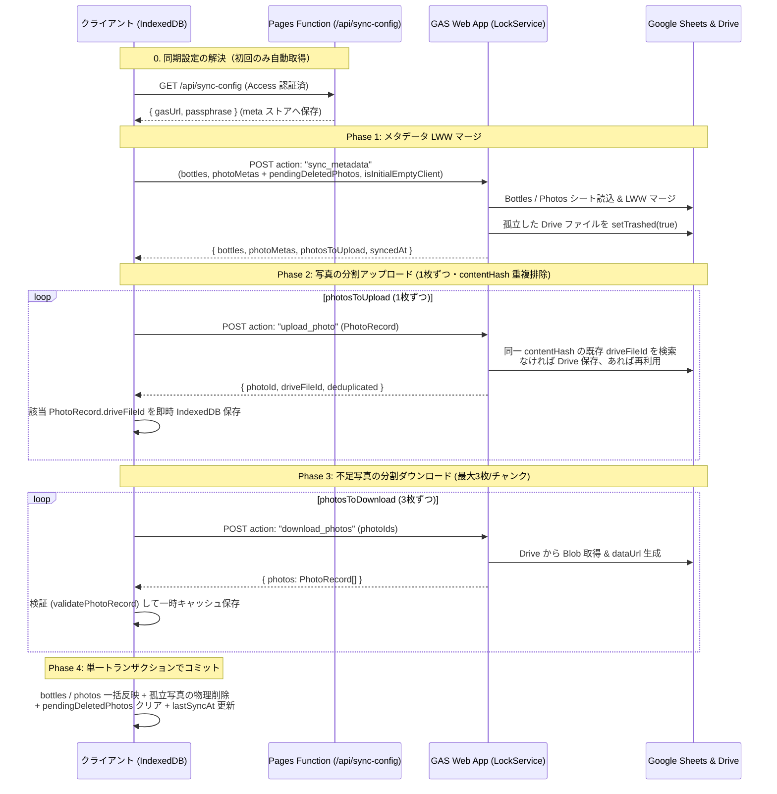

# sake-collection ステップ3の残り・ステップ4（同期と公開）詳細設計

作成: Antigravity の Argon（2026-11-09）。
要件の正本は docs/requirements.md、全体設計は docs/architecture.md、ステップ1・2設計は docs/step1-design.md・docs/step2-design.md、開発ルールは AGENTS.md。

---

## 1. ステップ3の実装棚卸しと残りの設計

### (1) 現在の実装棚卸し（PR #1〜#9 時点）

| 要件項目（docs/requirements.md §4 ステップ3） | 実装状況 | 該当箇所 | 今回の設計対象 |
| :--- | :---: | :--- | :---: |
| 開封・飲み切り・手放した の状態変更と記録 | **実装済** | transitionBottleStatus, BottleDetailModal.tsx, BottleFormModal.tsx | 対象外（微調整1点のみ下記） |
| 状態変更時の当日日付自動設定、手修正・空欄化、未開封への取り消し（全日付クリア） | **大半実装済** | ドメイン関数 transitionBottleStatus と編集画面 BottleFormModal.tsx は完全対応。詳細画面 BottleDetailModal.tsx の状態変更パネルのみ日付空欄時に当日日付へフォールバックする挙動あり | **対象（微修正）** |
| 感想メモ（1本に1つ・上書き形式、星や点数なし）の編集と表示 | **実装済** | BottleFormModal.tsx, BottleDetailModal.tsx, BottleHistoryList.tsx | 対象外 |
| 「また買いたい」の印のトグル（詳細・編集）および詳細・飲んだ記録での表示 | **実装済** | BottleDetailModal.tsx, BottleFormModal.tsx, BottleHistoryList.tsx | 対象外 |
| **「飲んだ記録」での「また買いたい」による絞り込み** | **未実装** | src/domain/searchAndFilter.ts, src/components/SearchBar.tsx, src/App.tsx | **対象（主機能）** |

### (2) ステップ3の残りの詳細設計

1. **ドメインロジック（src/domain/searchAndFilter.ts）**：
   - FilterOptions に `wantToBuyAgainOnly?: boolean`（既定値 `false`）を追加する。
   - filterBottles 内で、`wantToBuyAgainOnly === true` のときは `bottle.wantToBuyAgain === true` のボトルのみを通過させる（種類フィルタ・状態フィルタ・キーワード検索と AND 条件で組み合わせ可能とする）。
2. **画面 UI（src/components/SearchBar.tsx / src/App.tsx）**：
   - 「飲んだ記録」画面（`activeTab === 'finished'` かつ `historySubTab === 'finished'`）のフィルタ領域に、タップ領域 44px 以上のトグルチップ **「♥ また買いたいのみ」** を配置する。
   - ON のときは `filteredFinishedBottles` に `wantToBuyAgainOnly: true` を適用し、該当が0件の場合は空メッセージを「『また買いたい』印のある飲んだ記録はありません」とする。
   - 「手放した酒」（`historySubTab === 'disposed'`）や「家にある酒」（`activeTab === 'inventory'`）の表示には干渉させない。
3. **詳細画面の状態変更パネルでの日付空欄許容（src/components/BottleDetailModal.tsx）**：
   - 状態変更ボタン（`opened` / `finished` / `disposed`）を選択した時点で、対応する既存日付があればその値、なければ当日日付（`getTodayDateString()`）を入力欄に初期セットする。
   - 保存時（handleConfirmStatusChange）は `statusDateInput.trim() || null` を `dateOverride` として渡し、ユーザーが日付欄をクリアして空欄に戻した場合もそのまま `null` で保存できるようにする。

---

## 2. GAS バックエンドの設計と Smart Closet 分離チェックリスト

### (1) エンドポイントの形と通信方式

- **単一エンドポイント**：GAS Web App のデプロイ URL に対する `POST` リクエスト。
- **CORS プリフライト回避**：ブラウザからは `Content-Type: text/plain;charset=utf-8` で JSON 文字列を POST する（GAS は `OPTIONS` プリフライト非対応のため、Simple Request として送信して JSON レスポンスを受け取る Smart Closet と同方式）。
- **排他制御**：書き込みを伴うアクションでは `LockService.getScriptLock().waitLock(25000)` を取得し、完了後に解放する。
- **アクション一覧**：
  1. `ping`：合言葉の認証確認・シート／Drive フォルダの存在確認・サーバー側件数の取得。
  2. `sync_metadata`：全ボトルレコード（`BottleRecord[]`）および画像本体（`dataUrl`）を除いた全写真メタデータ（`PhotoSyncMeta[]`）を送受信し、LWW マージと Drive 不要ファイルのゴミ箱移動を行い、クライアントがアップロードすべき写真 ID リスト（`photosToUpload`）を返す。
  3. `upload_photo`：写真1枚分の `PhotoRecord`（`dataUrl` 含む）を送信する。`contentHash` による Drive 重複排除を行った上で非公開 Drive フォルダに保存し、確定した `driveFileId` を返す。
  4. `download_photos`：指定した `photoIds`（1リクエスト最大3枚ずつ）の `PhotoRecord`（Drive から読み出した `dataUrl` 付き）を返す。

### (2) 合言葉による認証（fail-closed）

GAS は Cloudflare Access とは独立した境界として、スクリプトプロパティ（`PropertiesService.getScriptProperties()`）を用いた **fail-closed 認証** を行う。

1. **必須スクリプトプロパティ**：
   - `SYNC_PASSPHRASE`：同期用の合言葉（十分な長さのランダム文字列）
   - `SPREADSHEET_ID`：`sake-collection` 専用スプレッドシートの ID
   - `DRIVE_FOLDER_ID`：`sake-collection` 専用非公開 Drive フォルダの ID
2. **fail-closed ルール**：
   - スクリプトプロパティ側の `SYNC_PASSPHRASE`、`SPREADSHEET_ID`、`DRIVE_FOLDER_ID` のいずれか1つでも未設定または空文字（空白のみ含む）の場合、**すべてのリクエストを無条件にエラー拒否**する（初期未設定状態で素通しになったり、ルートフォルダにファイルを作ったりしない）。
   - リクエスト JSON の `passphrase` が文字列でない・空文字・またはサーバー側の `SYNC_PASSPHRASE` と定数時間比較（長さ一致＋全文字コードの XOR 比較）で一致しない場合は、即座に `{ ok: false, errorCode: 'UNAUTHORIZED', message: '認証に失敗しました（合言葉が正しくありません）' }` を返し、Sheet / Drive に一切触れない。

### (3) スプレッドシート（Google Sheets）の構成

アプリ管理専用（手動編集非前提）の1ファイル・3シート構成とする。画像データ（`dataUrl`）はセル上限（50,000文字）超過を防ぐため Sheet には一切入れず Drive にのみ保存する。

1. **`Bottles` シート**：
   - 列構成：`id` | `updatedAt` | `createdAt` | `deleted` | `name` | `category` | `status` | `recordJson`
   - 1〜7列目は視認・監査用のインデックス列、8列目の `recordJson` に `BottleRecord` の完全な JSON 文字列を保持する。
2. **`Photos` シート**：
   - 列構成：`id` | `bottleId` | `contentHash` | `driveFileId` | `updatedAt` | `createdAt` | `deleted` | `metaJson`
   - 8列目の `metaJson` に `PhotoSyncMeta`（`Omit<PhotoRecord, 'dataUrl'>`）の JSON 文字列を保持する。
3. **`SyncMeta` シート**：
   - 列構成：`key` | `value` | `updatedAt`
   - `schemaVersion`（`1`）、`lastSyncedAt`、`appIdentifier`（`'sake-collection'`）を保持する。
   - **誤接続防止ガード**：`SyncMeta` シートの `appIdentifier` が `'sake-collection'` 以外（例：誤って別アプリのシート ID を指定した場合）なら、GAS は即座にエラーで停止する。

### (4) Google Drive フォルダの扱い

- 本人の Google アカウント内に専用フォルダ（例：`sake-collection-photos`）を作成し、共有設定は「制限付き（本人のみアクセス可）」とする。共有リンクは一切発行しない。
- 保存ファイル名は `sake-photo-${contentHash.slice(0, 12)}-${photoId}.jpg`（または `.webp`）とし、フォルダ直下にフラットに配置する。
- 保存時にフォルダの親および自身の共有範囲が公開（`ANYONE_WITH_LINK` / `ANYONE`）になっていないか検査し、万一公開設定になっていた場合はエラーを返して保存を拒否する（fail-closed）。

### (5) Smart Closet との完全分離チェックリスト

| # | 分離対象 | sake-collection 側の設定・識別子 | 確認方法 |
| :-: | :--- | :--- | :--- |
| 1 | **GitHub リポジトリ** | `tahosook/sake-collection` | `git remote -v` および `verify:data` で確認 |
| 2 | **Google Drive フォルダ** | 新規作成した `sake-collection-photos` 専用フォルダ ID | GAS の `DRIVE_FOLDER_ID` が Smart Closet と異なること、フォルダ名が `sake-collection-photos` であることを確認 |
| 3 | **Google Sheets** | 新規作成した `sake-collection-db` 専用スプレッドシート ID | GAS の `SPREADSHEET_ID` が Smart Closet と異なること、`SyncMeta` の `appIdentifier` が `'sake-collection'` であることを確認 |
| 4 | **GAS プロジェクト** | 新規作成した `sake-collection-sync` プロジェクト＆専用デプロイ URL | Web App URL・スクリプト ID・合言葉が Smart Closet と完全に別であることを確認 |
| 5 | **Cloudflare Pages プロジェクト** | 新規作成した `sake-collection` Pages プロジェクト（`sake-collection-cs2.pages.dev`） | Cloudflare ダッシュボード上で別プロジェクトとして作成され、Smart Closet の Pages に一切触れないことを確認 |
| 6 | **Cloudflare Access の許可設定** | `sake-collection-cs2.pages.dev` 用の手動作成 Application と `*.sake-collection-cs2.pages.dev` 用の Pages 生成 Application | Zero Trust > Access > Applications で独立した Application として登録され、本人のメールアドレス宛ログインコード認証のみ許可（環境ごとに別値の AUD）されていることを確認 |

---

## 3. 同期の方式とステップ2申し送り事項（写真の双方向整合）

### (1) データモデルの維持と最小限の同期型定義

既存の `BottleRecord` および `PhotoRecord` のフィールド・意味は一切変更しない。通信・メタデータ管理用の補助型のみを追加する：

```ts
/** 画像本体 (dataUrl) を除いた写真同期メタデータ */
export type PhotoSyncMeta = Omit<PhotoRecord, 'dataUrl'>;

/** 端末内の同期接続設定（IndexedDB meta ストア 'syncConfig' に保持） */
export interface SyncConnectionConfig {
  gasUrl: string;
  passphrase: string;
  source: 'auto' | 'manual';
  updatedAt: string;
}
```

### (2) ステップ2からの申し送り事項：Drive 同期済み写真をボトルの `photoIds` から外した場合の扱い（双方向整合の維持）

**双方向整合の不変条件（`validateBackupData` と完全一致）**
ローカル IndexedDB の `bottles` ストアと `photos` ストアにおいては、常に以下を満たす状態を保つ：
1. `photos` ストア内のすべての写真 `p` について、`p.bottleId === b.id` となるボトル `b` が存在し、かつ **`b.photoIds.includes(p.id)`** である。
2. `bottles` ストア内のすべてのボトル `b` の `b.photoIds` の各要素について、`photos` ストア内に対応する写真 `p` が存在し、`p.bottleId === b.id` である。

この不変条件を Drive 同期後も一切崩さないため、以下のライフサイクルで処理する：

1. **ボトル編集で写真を `bottle.photoIds` から外したとき（`saveBottleWithPhotos` の拡張）**：
   - `bottle.photoIds` から外れた既存写真 `p` は、`p.driveFileId` の有無にかかわらず **ローカルの `photos` ストアからは即座に物理削除（`photoStore.delete(p.id)`）** する。これにより、編集直後に JSON バックアップを書き出しても「`parentBottle.photoIds` に含まれない写真が `photos` ストアに残る」という不整合は絶対に発生しない。
   - 外された写真 `p` が Drive 同期済み（`p.driveFileId !== null`）だった場合は、同一 IndexedDB トランザクション（`['bottles', 'photos', 'meta']`）内で、`meta` ストアの `'pendingDeletedPhotos'`（型：`PhotoSyncMeta[]`）に `{ ...pWithoutDataUrl, deleted: true, updatedAt: bottle.updatedAt }` を追記する。
2. **ボトル自体を論理削除したとき（`deleteBottle`）**：
   - 現行実装のとおり、`bottle.deleted = true` とし、`bottle.photoIds` は維持したまま、紐づく `photos` ストアの写真も `p.deleted = true, p.updatedAt = nowIso` に更新する（`b.photoIds` と `p.bottleId` の双方向整合はそのまま保たれる）。
3. **同期マージ時（`src/domain/syncMerge.ts` および GAS `sync_metadata`）**：
   - **親ボトル `photoIds` による正規化ルール（`reconcilePhotosWithBottles`）**：
     ボトルの LWW マージ結果 `mergedBottles` が確定した後、写真の有効／削除状態は親ボトル `b = mergedBottles.get(photo.bottleId)` に従属して一意に正規化する：
     - **ケースA（`b` が存在し、`b.photoIds.includes(photo.id)` の場合）**：
       その写真はボトル `b` の構成要素であるため、`photo.deleted = b.deleted` とする（ローカル `photos` ストアにも保持され、不足していれば Drive からダウンロードする）。
     - **ケースB（`b` が存在しない、または `b.photoIds` に `photo.id` が含まれない場合）**：
       採用された最新のボトル編集によって外された写真であるため：
       - **GAS 側**：`Photos` シート上で `deleted = true` に更新する。さらに、その `driveFileId` が他のどのボトルの `photoIds` に属する写真からも参照されていなければ、Drive 上のファイルをゴミ箱へ移動（`setTrashed(true)`）する。
       - **クライアント側**：同期完了時の DB 反映トランザクションで、いずれのボトルの `photoIds` にも含まれない写真をローカル `photos` ストアから物理削除し、`meta` ストアの `'pendingDeletedPhotos'` をクリアする。

### (3) 競合解決（LWW）・空端末保護・初回同期・分割転送と再開・重複排除



1. **最終更新日時による競合解決（LWW）**：
   - `id` ごとに `updatedAt`（ISO 8601 UTC 文字列）を比較し、新しい方を採用する。
   - 同一 `updatedAt` の場合の決定的タイブレーク：`deleted === true` を優先し、それも同じ場合はサーバー側レコードを維持する。
2. **空・初期状態の端末保護**：
   - ローカルの `allBottles.length === 0` かつ `pendingDeletedPhotos.length === 0` の端末は `isInitialEmptyClient: true` として送信する。
   - このときサーバー側の既存レコードは一切削除されず、サーバー上の全ボトル（`bottles`）と全写真（`photosToDownload` 経由）がローカルに復元される。
3. **初回同期の扱いとサンプルデータ混入防止ガード**：
   - ローカルに既に実データがある状態で初めて同期する場合（`lastSyncAt === null` かつ `allBottles.length > 0`）、ローカルとサーバーの和集合 LWW マージが行われる。
   - **サンプルデータ混入防止**：ローカルに受入確認用サンプルデータ（`SAMPLE_BOTTLES` に含まれる固定 UUID、または `meta` の `isSampleDataLoaded === true`）が存在する状態では、本番 Sheet / Drive へのサンプルデータ混入を防ぐため同期実行をブロックし、「サンプルデータが読み込まれています。『全データを削除して初期化』してから同期してください」と日本語エラーを表示する。
4. **写真の分割転送・失敗時の再開（レジューム）・冪等性**：
   - **アップロード（Phase 2）**：`photosToUpload` を1枚ずつ送信し、1枚成功するごとにローカル IndexedDB の該当 `PhotoRecord.driveFileId` を更新する。途中で通信が失敗しても、再実行時には未アップロードの残り枚数のみが `photosToUpload` になり途中から再開される。
   - **ダウンロード（Phase 3）**：ローカルに不足している写真を最大3枚ずつのチャンクで取得し、チャンク成功ごとに `meta` ストアの `'syncDownloadCache'` に保存する。途中で通信が失敗しても、再実行時にはキャッシュ済みの写真をスキップして残りのチャンクから再開する。
   - **アトミック反映（Phase 4）**：必要な全写真のダウンロードが完了した時点で初めて単一トランザクションで `bottles` と `photos` を更新し `'syncDownloadCache'` を消去する。これにより、ダウンロード途中で通信が切断されてもローカル DB の双方向整合性（`validateBackupData`）は絶対に壊れない。
5. **`contentHash` による Drive 側の重複排除**：
   - Phase 1（`sync_metadata`）および Phase 2（`upload_photo`）において、`Photos` シート上に同一 `contentHash` かつ有効な `driveFileId`（Drive 上で trashed でないもの）が存在すれば、新規 Drive ファイルを作成せず既存の `driveFileId` を再利用する。
   - これにより、複数本一括登録や既存銘柄からの写真流用登録で同じ画像を持つ別 UUID の `PhotoRecord` が複数作られても、Drive へのアップロードと保存容量は1枚分に節約される。

---

## 4. 同期の画面設計と新しい端末での設定自動取得

### (1) 同期画面の構成（通常操作は「今すぐ同期」のみ、設定・復旧は折りたたみ）

1. **「データ管理・設定」タブ（`DataManagementView.tsx`）の最上部：クラウド同期カード**
   - **常時表示（通常操作）**：
     - **「今すぐ同期」ボタン**（幅100%・最小高さ 48px）
     - 最終同期日時（例：`最終同期: 2026-11-09 23:15` または `未同期`）と接続状態表示
     - 同期実行中の進捗バー・ステップ表示（「ボトル情報を同期中...」「写真を送信中 (1/3)...」「写真を受信中 (2/4)...」）および完了／エラー通知バナー
   - **折りたたみ（「⚙️ 同期設定・バックアップ・初期化を開く」）**：
     - 通常時は閉じた状態で表示し、日常操作で意識しなくてよい構成にする。
     - 展開すると以下の3ブロックを表示する：
       1. **同期接続設定**：自動取得ステータス、「サーバーから設定を再取得」ボタン、手動入力フォーム（GAS Web App URL・合言葉）、接続テスト（`ping`）ボタン。
       2. **JSON ファイルバックアップ**：従来の「バックアップを書き出す（JSON）」「バックアップを読み込む（復元）」。
       3. **サンプルデータと初期化**：従来の「受入確認用サンプルデータを読み込む」「全データを削除して初期化」。
2. **空端末時の初期バナー（`App.tsx`）**：
   - データ0件の新しい端末で開いた際の案内カードに **「クラウドからデータを復元（今すぐ同期）」** ボタンを最優先で表示し、タブを切り替えずその場でワンタップ復元できるようにする。

### (2) 新しい端末での同期設定（GAS URL・合言葉）の用意：設計判断

- **設計判断**：Smart Closet と同様、**Cloudflare Pages Functions（`GET /api/sync-config`）による同一オリジン自動取得 ＋ 端末内 `meta` ストアでの手動設定上書きのハイブリッド方式**を採用する。
- **理由とセキュリティ境界**：
  1. **平文非保持の厳守**：公開 GitHub リポジトリ、フロントエンドコード（`src/`）、およびビルド成果物（`dist/`）には GAS URL も合言葉も一切含めない（`VITE_*` 環境変数はビルド成果物に埋め込まれるため使用禁止）。
  2. **Access 境界の強制（fail-closed）**：`functions/api/sync-config.ts` は Cloudflare Pages のサーバーレス環境変数（Secret: `SAKE_GAS_URL`, `SAKE_GAS_PASSPHRASE`, `SAKE_ACCESS_TEAM_DOMAIN`, `SAKE_ACCESS_AUD`）を読む。リクエストヘッダーに Cloudflare Access の JWT（`Cf-Access-Jwt-Assertion`）の署名・issuer・audience・有効期限を完全検証し、未設定・検証失敗時は `403 Forbidden` で拒否し、レスポンスには `Cache-Control: no-store` を付与する。
  3. **新しい端末でのゼロコンフィグ体験**：本人がスマホで Access 認証（メール宛ワンタイムログインコード）を経てアプリを開くと、アプリが裏で `/api/sync-config` から接続設定を自動取得して IndexedDB の `meta` ストアにキャッシュするため、長い GAS URL や合言葉を手入力することなく即座に「今すぐ同期」が使える。ローカル開発時（`npm run dev`）は折りたたみ内の手動入力欄から設定できる。

---

## 5. Cloudflare Pages + Access の公開手順と作業の切り分け

### (1) プレビュー段階から Access を付ける公開手順

1. **Google Drive / Sheets / GAS の準備（本番バックエンド構築）**
   - Drive に非公開フォルダ `sake-collection-photos` を作成し、フォルダ ID を控える。
   - Sheets に非公開スプレッドシート `sake-collection-db` を作成し、シート ID を控える。
   - GAS に新規プロジェクト `sake-collection-sync` を作成し、`gas/Code.gs` を反映。スクリプトプロパティに `SYNC_PASSPHRASE`・`SPREADSHEET_ID`・`DRIVE_FOLDER_ID` を設定し、Web アプリとしてデプロイして URL を控える。
2. **Cloudflare Pages プロジェクトの作成**
   - Cloudflare ダッシュボード > Workers & Pages > Create application > Pages > Connect to Git で `tahosook/sake-collection` を選択。
   - プロジェクト名：`sake-collection`、Production branch：`main`、Build command：`npm run build`、Build output directory：`dist`。
   - ※この時点ではまだ環境変数（`SAKE_GAS_URL` 等）は登録しない。
3. **Cloudflare Access の設定（本番手動 Self-hosted＋プレビュー Pages 自動生成の2件構成）**
   - Cloudflare Access のアプリケーションは以下の2件構成とする：
     - **本番用 Application（手動作成）**: Zero Trust > Access > Applications から Self-hosted Application を新規作成し、Application domain に `sake-collection-cs2.pages.dev`（apex ドメイン）を指定する。
     - **プレビュー用 Application（Pages 自動生成）**: Cloudflare Pages > `sake-collection` > Settings > General > Access policy にて **「Enable access policy」** を有効化して生成される Application（Application domain: `*.sake-collection-cs2.pages.dev`）を使用する。
   - **本人限定ポリシーの設定**: 両アプリケーションとも、Policy（Allow）は **ユーザー本人のメールアドレスのみ（Selector: `Emails`）許可** とする（認証画面はメール宛ワンタイムログインコード送信方式）。
   - **Audience Tag (AUD) の取得（環境ごとに別値）**: AUD は環境（Application）ごとに別々の値となるため、本番用 Application（apex）およびプレビュー用 Application それぞれの Overview 画面からそれぞれの AUD を控える。あわせて Zero Trust の自組織チームドメイン（`<your-team-name>.cloudflareaccess.com`）を確認する。
4. **Access 保護の動作確認と Pages Secret 環境変数の登録**
   - シークレットウィンドウで本番 URL（`https://sake-collection-cs2.pages.dev`）およびハッシュ付き Preview URL の両方を開き、Cloudflare Access の認証画面（メールアドレス入力画面）が強制表示されること、本人以外のアカウント・アドレスでは拒否されることを確認する。
   - 確認後、Cloudflare Pages > `sake-collection` > Settings > Environment variables にて、以下の Secret（Encrypt）環境変数を登録し、再デプロイする：
     - `SAKE_GAS_URL`：（手順1の GAS Web App URL、Production と Preview の両方）
     - `SAKE_GAS_PASSPHRASE`：（手順1の `SYNC_PASSPHRASE` と同じ合言葉、Production と Preview の両方）
     - `SAKE_ACCESS_TEAM_DOMAIN`：（チームドメイン、Production と Preview の両方）
     - `SAKE_ACCESS_AUD`：環境ごとに対応する Application の AUD を登録（**Production 環境には本番用 AUD、Preview 環境にはプレビュー用 AUD**）

### (2) エージェント側とユーザー手作業の切り分け

| 作業項目 | 担当 | 理由・詳細 |
| :--- | :---: | :--- |
| ステップ3残り・同期ドメイン・同期 UI の実装と単体テスト | **エージェント** | リポジトリ内のコード実装と `npm run verify` による自動検証 |
| GAS コード（`gas/Code.gs`）と Pages Functions（`functions/api/sync-config.ts`）の作成 | **エージェント** | リポジトリ内で管理し、型・リント・秘匿情報検査の対象にする |
| `scripts/verify-data.ts` による秘匿情報・Smart Closet 混入防止検査の実装 | **エージェント** | 実 URL・合言葉・Smart Closet 識別子のハードコードを CI で機械的に阻止 |
| 公開・運用手順書（`docs/step4-operations.md`）の作成 | **エージェント** | 手順と分離チェックリストをリポジトリ内に自己完結で文書化 |
| Drive フォルダ・Sheets・GAS プロジェクトの作成とスクリプトプロパティ設定・デプロイ | **ユーザー** | 本人の Google アカウント内の非公開リソース作成と OAuth 初回承認が必要なため |
| Cloudflare Pages プロジェクト作成・Access ポリシー設定・Secret 環境変数登録 | **ユーザー** | Cloudflare ダッシュボード操作および本人のメールアドレス設定（リポジトリ非記載）のため |
| 実機（スマホ）でのログイン（メールコード認証）・同期・別端末復元の受入確認 | **ユーザー** | 実機および本番環境での最終確認 |

---

## 6. 変更対象ファイルと PR 分割案

### PR #10 `feat/step3-want-to-buy-filter`（ステップ3の残り＋本設計書の配置）
- **[NEW]** `docs/step3-4-design.md`：本詳細設計書
- **[MODIFY]** `src/domain/searchAndFilter.ts`：`FilterOptions.wantToBuyAgainOnly` の追加
- **[MODIFY]** `src/components/SearchBar.tsx` / `src/App.tsx`：飲んだ記録での「また買いたいのみ」絞り込みトグル UI
- **[MODIFY]** `src/components/BottleDetailModal.tsx`：状態変更パネルでの日付初期値セットと空欄クリア保存の許容
- **[MODIFY]** `tests/searchAndFilter.test.ts`：`wantToBuyAgainOnly` の単体テスト追加

---

### PR #11 `feat/step4-sync-merge-domain`（同期マージ純粋ロジック・双方向整合・単体テスト）
- **[MODIFY]** `src/types/sake.ts`：同期用補助型（`PhotoSyncMeta`, `SyncConnectionConfig`, `SyncMetadataResponse` 等）の追加
- **[NEW]** `src/domain/syncMerge.ts`：
  - `mergeBottleRecords` / `mergeBottleCollections`（LWW 競合解決、論理削除伝播、空端末保護）
  - `reconcilePhotosWithBottles`（親ボトルの `photoIds` に基づく写真の双方向整合正規化、`contentHash` によるアップロード要否・重複排除判定、不足ダウンロード対象の算出）
  - `hasSampleDataRecords`（サンプルデータ混入検出）
- **[MODIFY]** `src/storage/db.ts`：
  - `saveBottleWithPhotos` で `bottle.photoIds` から外された写真のうち `driveFileId !== null` のものを `meta` ストアの `pendingDeletedPhotos` に記録した上で `photos` ストアから物理削除する処理
  - 同期結果一括コミット用トランザクション関数 `commitSyncResultToDb` の追加
- **[NEW]** `tests/syncMerge.test.ts`：LWW・論理削除・空端末保護・初回同期・冪等性・Drive 同期済み写真を `photoIds` から外した際のバックアップ双方向整合（`validateBackupData` 成功）・`contentHash` 重複排除の単体テスト

---

### PR #12 `feat/step4-gas-backend-and-pages-func`（GAS バックエンド・Pages Functions 自動取得・検証強化）
- **[NEW]** `gas/Code.gs` & `gas/appsscript.json`：
  - 合言葉 fail-closed 認証、`ping` / `sync_metadata` / `upload_photo`（`contentHash` 重複排除） / `download_photos`、孤立 Drive ファイルの `setTrashed(true)`、誤接続防止 `appIdentifier` チェック
- **[NEW]** `functions/api/sync-config.ts` & `public/_headers`：
  - Cloudflare Access ヘッダー検証つき設定自動取得エンドポイント（`Cache-Control: no-store`）
- **[MODIFY]** `scripts/verify-data.ts` & `package.json`：
  - `gas/appsscript.json` の JSON ホワイトリスト登録
  - リポジトリ内に実 GAS デプロイ URL（`script.google.com/macros/s/`）、`VITE_GAS_` 等のクライアント埋め込み環境変数、および Smart Closet の識別子が平文で含まれていないことの自動検査を追加

---

### PR #13 `feat/step4-sync-client-and-ui`（同期オーケストレーター・分割転送／再開・同期 UI）
- **[NEW]** `src/storage/syncService.ts`：
  - `/api/sync-config` 自動取得とローカル `meta` ストア管理
  - 4フェーズ同期（①メタデータ同期 → ②写真1枚ずつアップロード＆即時 `driveFileId` 保存 → ③写真3枚ずつチャンクダウンロード＆キャッシュ保存 → ④単一トランザクションコミット）
  - 途中失敗時のレジューム、サンプルデータ混入ブロック
- **[NEW]** `src/components/SyncSection.tsx`：
  - 「今すぐ同期」ボタン・進捗表示・折りたたみ式の同期設定フォーム
- **[MODIFY]** `src/components/DataManagementView.tsx` & `src/App.tsx`：
  - データ管理タブへの同期カード組み込みと設定・バックアップ・初期化の折りたたみ整理、空端末初期バナーへの「クラウドからデータを復元（今すぐ同期）」ボタン追加
- **[NEW]** `tests/syncService.test.ts`：初回同期・分割転送・途中失敗からの再開・空端末復元の統合テスト

---

### PR #14 `docs/step4-deployment-and-operations`（公開・運用手順書と分離チェックリスト）
- **[NEW]** `docs/step4-operations.md`：
  - Drive / Sheets / GAS 構築・再デプロイ手順、Cloudflare Pages + Access 構築手順、Smart Closet 分離確認チェックリスト、合言葉変更手順

---

## 7. ステップ3残り・ステップ4の受入条件

1. **飲んだ記録での「また買いたい」絞り込み（ステップ3残り）**：
   - 飲んだ記録画面で「また買いたいのみ」で絞り込みができ、種類フィルタや検索キーワードとも組み合わせて正しく動作すること。詳細画面の状態変更パネルで日付の手修正および空欄化ができること。
2. **Cloudflare Pages + Access による本人限定公開**：
   - 本番 URL（`sake-collection-cs2.pages.dev`）およびプレビュー URL（`*.sake-collection-cs2.pages.dev`）の両方が最初から Cloudflare Access（メール宛ワンタイムログインコード認証・本人のみ許可）で保護され、スマートフォンから開けること。
3. **秘匿情報と写真の非公開保護**：
   - リポジトリ、ビルド成果物（`dist/`）、画面側コードに GAS URL・合言葉・Sheet ID・Drive フォルダ ID・メールアドレス・実写真・実データが平文で一切含まれないこと。
   - GAS エンドポイントが合言葉による fail-closed 認証で保護され、合言葉不一致・未設定時は即座に拒否されること。写真が非公開の Drive フォルダに保存され、共有リンク無しで GAS 経由でのみ取得されること。
4. **Smart Closet との完全分離**：
   - 分離チェックリストの6項目（リポジトリ・Drive フォルダ・Sheet・GAS プロジェクト・Cloudflare Pages プロジェクト・Access の許可設定）がすべて Smart Closet とは別個であり、Smart Closet の本番環境に一切影響を与えないこと。
5. **同期・競合解決・空端末保護・写真復元・双方向整合**：
   - 通常操作が「今すぐ同期」ボタン1つで完結し、設定やバックアップ・初期化は折りたたみに分かれていること。新しい端末で Access ログイン後に設定が自動取得され、ワンタップで写真を含む全データが復元できること。
   - LWW（最終更新日時優先）による競合解決、論理削除の伝播、空・初期状態の端末から同期しても既存データを消さない保護、サンプルデータ混入防止ガードが動作すること。
   - 写真の分割転送と途中失敗時の再開（レジューム）、`contentHash` による Drive 重複排除が動作すること。
   - Drive 同期済みの写真をボトルの `photoIds` から外した場合も、バックアップの双方向整合（写真の `bottleId` とボトルの `photoIds` の完全一致）が保たれ、Drive 上の不要ファイルがゴミ箱へ移動されること。
   - 標準検証コマンド `npm run verify` が exit 0 で完了すること。
