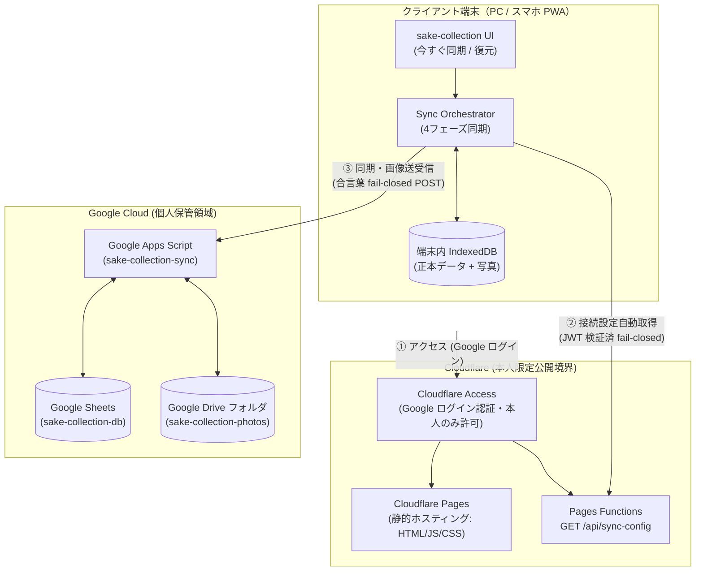

# sake-collection 公開・運用手順書

作成日: 2026-11-10
対象: ステップ4（クラウド同期と本人限定公開）
正本設計書: `docs/step3-4-design.md`

本書は、sake-collection のクラウド同期バックエンド（Google Drive / Sheets / GAS）およびホスティング・アクセス制御（Cloudflare Pages + Access）の初期構築、公開設定、受入確認、完全分離検証、および日常の運用・保守手順を定める正本手順書です。

> [!CAUTION]
> **秘匿情報・個人情報の取り扱いに関する厳守事項**
> 本リポジトリは公開（Public）です。本書内の手順を実行する際、個人のメールアドレス、Google リソースの実 ID、実際の合言葉（Passphrase）、GAS デプロイ URL の実値をコミットしたり、PR 本文・Issue・ログに出力したりすることは絶対に避けてください。本書中ではすべて `<...>` 形式のプレースホルダで表記しています。

---

## 目次

1. [全体アーキテクチャとセキュリティ境界](#1-全体アーキテクチャとセキュリティ境界)
2. [Google 側バックエンドリソースの構築手順](#2-google-側バックエンドリソースの構築手順)
   - [2.1 Google Drive フォルダの作成](#21-google-drive-フォルダの作成)
   - [2.2 Google スプレッドシートの作成](#22-google-スプレッドシートの作成)
   - [2.3 Google Apps Script (GAS) の作成と設定](#23-google-apps-script-gas-の作成と設定)
   - [2.4 GAS Web アプリのデプロイ](#24-gas-web-アプリのデプロイ)
3. [Cloudflare Pages + Access の公開手順](#3-cloudflare-pages--access-の公開手順)
   - [3.1 Cloudflare Pages プロジェクトの作成](#31-cloudflare-pages-プロジェクトの作成)
   - [3.2 Cloudflare Access（Zero Trust）の設定](#32-cloudflare-accesszero-trustの設定)
   - [3.3 Pages Secret 環境変数の登録](#33-pages-secret-環境変数の登録)
   - [3.4 Access 保護と設定自動取得の疎通確認](#34-access-保護と設定自動取得の疎通確認)
4. [先行アプリとの完全分離チェックリスト（6項目）](#4-先行アプリとの完全分離チェックリスト6項目)
5. [ステップ4 受入確認手順（設計書 §7）](#5-ステップ4-受入確認手順設計書-7)
6. [日常運用・保守ガイド](#6-日常運用保守ガイド)
   - [6.1 同期の基本操作](#61-同期の基本操作)
   - [6.2 バックアップとリストア](#62-バックアップとリストア)
   - [6.3 合言葉（パスフレーズ）の変更手順](#63-合言葉パスフレーズの変更手順)
   - [6.4 GAS コードの更新手順（再デプロイ）](#64-gas-コードの更新手順再デプロイ)
   - [6.5 トラブルシューティング（FAQ）](#65-トラブルシューティングfaq)

---

## 1. 全体アーキテクチャとセキュリティ境界

sake-collection は、端末内 IndexedDB を正本とする**ローカルファースト PWA** です。複数端末間のデータ同期と写真のバックアップのために、Google Workspace（Sheets / Drive / GAS）と Cloudflare（Pages / Access / Functions）を組み合わせたゼロトラスト構成を採用しています。

### 主要なセキュリティ原則
1. **GitHub 公開リポジトリへの平文非保持**:
   - GAS URL や合言葉などの秘密情報は、ソースコード・ビルド成果物（`dist/`）に一切含めません（`VITE_*` 環境変数の使用禁止）。
2. **多層防御（2つの独立した境界）**:
   - **画面側境界（Cloudflare Access）**: ユーザー本人の Google アカウントのみがアクセス可能。未認証アクセスは Pages Functions も含めて `403 Forbidden` / ログインリダイレクト。
   - **データ側境界（GAS Web アプリ）**: Access を万一バイパスされた場合でも、共有シークレット（`SYNC_PASSPHRASE`）による定数時間比較の fail-closed 認証で保護。
3. **写真の完全非公開保護**:
   - 写真が保存される Google Drive フォルダは「リンクを知っている全員」を禁止（制限付き）とし、GAS 経由でのみ中継・取得されます。

---

## 2. Google 側バックエンドリソースの構築手順

Google アカウントにログインした状態で、以下の手順を順番に実施します。

### 2.1 Google Drive フォルダの作成
酒の写真（リサイズ済み画像）を非公開で保管する専用フォルダを作成します。

1. Google Drive（`https://drive.google.com/`）を開きます。
2. 左上の「＋ 新規」>「新しいフォルダ」をクリックします。
3. フォルダ名に **`sake-collection-photos`** と入力して作成します。
4. 作成したフォルダを右クリックし、「共有」>「共有」を開きます。
5. **一般的なアクセス** が **「制限付き」**（自分のみアクセス可能）になっていることを確認します（「リンクを知っている全員」には絶対にしないでください）。
6. ブラウザのアドレスバーの URL から、フォルダ ID をコピーして安全に控えます。
   - URL 例: `https://drive.google.com/drive/folders/<DRIVE_FOLDER_ID>`

### 2.2 Google スプレッドシートの作成
コレクションのメタデータ（ボトル情報・写真メタ情報・同期メタ情報）を保管する専用スプレッドシートを作成します。

1. Google スプレッドシート（`https://sheets.google.com/`）を開きます。
2. 「空白のスプレッドシート」を作成します。
3. タイトルに **`sake-collection-db`** と入力します。
4. アドレスバーの URL から、スプレッドシート ID をコピーして安全に控えます。
   - URL 例: `https://docs.google.com/spreadsheets/d/<SPREADSHEET_ID>/edit`
5. ※シート（`Bottles`, `Photos`, `SyncMeta`）の作成やヘッダーの設定は、初回同期時に GAS が自動作成するため手動での作成は不要です。

### 2.3 Google Apps Script (GAS) の作成と設定
同期 API を処理する Web アプリケーションプロジェクトを作成します。

1. Google Apps Script（`https://script.google.com/`）を開きます。
2. 左上の「新しいプロジェクト」をクリックします。
3. プロジェクト名を **`sake-collection-sync`** に変更します。
4. **マニフェストファイル（`appsscript.json`）の反映**:
   - 左メニューの「プロジェクトの設定」（歯車アイコン）をクリックします。
   - 「「appsscript.json」マニフェスト ファイルをエディタで表示する」にチェックを入れます。
   - 左メニューの「エディタ」（＜＞アイコン）に戻り、`appsscript.json` を開きます。
   - リポジトリ内の `gas/appsscript.json` の内容をコピーして貼り付け、保存します。
5. **コードファイル（`Code.gs`）の反映**:
   - `コード.gs`（または `Code.gs`）を開きます。
   - リポジトリ内の `gas/Code.gs` の内容をすべてコピーして貼り付け、保存します。
6. **スクリプトプロパティの設定**:
   - 左メニューの「プロジェクトの設定」（歯車アイコン）をクリックします。
   - 画面下部の「スクリプト プロパティ」セクションで「スクリプト プロパティを追加」をクリックし、以下の **3つ** のプロパティを登録します。

| プロパティ名 | 値 | 説明 |
| :--- | :--- | :--- |
| `SYNC_PASSPHRASE` | `<強力なランダム合言葉>` | 32文字以上のランダム文字列（例: `openssl rand -hex 24` で生成） |
| `SPREADSHEET_ID` | `<SPREADSHEET_ID>` | 手順 2.2 で控えたスプレッドシート ID |
| `DRIVE_FOLDER_ID` | `<DRIVE_FOLDER_ID>` | 手順 2.1 で控えた Google Drive フォルダ ID |

### 2.4 GAS Web アプリのデプロイ
1. エディタ右上の「デプロイ」>「新しいデプロイ」をクリックします。
2. 種類の選択（歯車アイコン）で **「ウェブアプリ」** を選択します。
3. 設定項目を以下のように入力します：
   - **説明**: `sake-collection sync backend v1`
   - **次のユーザーとして実行**: **「自分」**（あなたの Google アカウント）
   - **アクセスできるユーザー**: **「全員」**（Anyone）
     - ※アクセス制御は GAS 側のコード内で `SYNC_PASSPHRASE` による fail-closed 認証（定数時間比較）で行われます。
4. 「デプロイ」をクリックします。
5. 初回デプロイ時は「アクセスを承認」画面が表示されるため、自分のアカウントを選択し、警告画面が出た場合は「詳細」>「sake-collection-sync（安全ではないページ）に移動」をクリックして権限を承認します。
6. デプロイ完了画面に表示される **ウェブアプリ URL** をコピーして安全に控えます。
   - URL 形式: `https://script.google.com/macros/s/<DEPLOYMENT_ID>/exec`

---

## 3. Cloudflare Pages + Access の公開手順

Cloudflare ダッシュボードにログインし、本番およびプレビュー環境のホスティングとアクセス制御を構築します。

### 3.1 Cloudflare Pages プロジェクトの作成
1. Cloudflare ダッシュボード > **Workers & Pages** > **Create application** > **Pages** タブ > **Connect to Git** をクリックします。
2. GitHub アカウントを連携し、リポジトリ **`tahosook/sake-collection`** を選択します。
3. ビルド構成を以下のように設定します：
   - **Project name**: `sake-collection`
   - **Production branch**: `main`
   - **Framework preset**: `None`（または `Vite`）
   - **Build command**: `npm run build`
   - **Build output directory**: `dist`
4. ※環境変数（Secrets）はこの段階では登録せず、まずは「Save and Deploy」をクリックして初回のビルド・デプロイを走らせます。
5. デプロイ完了後、割り当てられたドメイン（`https://sake-collection.pages.dev`）を確認します。

### 3.2 Cloudflare Access（Zero Trust）の設定
本番環境およびすべてのプレビュー環境を、Google ログインによる本人限定アクセスで保護します。

1. Cloudflare ダッシュボード > 左メニュー **Zero Trust** を開きます。
2. **Access** > **Applications** > **Add an application** をクリックし、**Self-hosted** を選択します。
3. **Application Configuration**:
   - **Application name**: `sake-collection`
   - **Session Duration**: `24 hours`（または任意）
   - **Application domain**: 以下の **2つのドメイン** を登録します。
     - 本番: `sake-collection.pages.dev`
     - プレビュー全域: `*.sake-collection.pages.dev`
4. **Identity Providers**:
   - `Google` を選択（有効化されていない場合は Zero Trust > Settings > Authentication で Google IdP を追加）。
5. **Policy の追加**:
   - **Policy name**: `Allow Owner Only`
   - **Action**: `Allow`
   - **Configure rules**:
     - **Selector**: `Emails`
     - **Value**: `<あなたのGoogleアカウントのメールアドレス>`（リポジトリには記載しない）
6. **Audience Tag (AUD) の取得**:
   - 作成した Application（`sake-collection`）の **Overview** 画面を開きます。
   - 画面内に表示されている **Audience Tag (AUD)**（英数字の長いハッシュ文字列）をコピーして控えます。
7. **チームドメイン（Team Domain）の確認**:
   - Zero Trust > Settings > Custom Pages または Overview から、自組織のチームドメインを確認して控えます。
   - 例: `<your-team-name>.cloudflareaccess.com`

### 3.3 Pages Secret 環境変数の登録
Pages Functions（`/api/sync-config`）が Access JWT の完全検証を行い、GAS URL と合言葉を安全にクライアントへ返すための環境変数を設定します。

1. Cloudflare ダッシュボード > **Workers & Pages** > **`sake-collection`** を開きます。
2. **Settings** > **Environment variables** を開きます。
3. **Production** と **Preview** の **両方の環境** に対して、以下の **4つ** の変数を **Encrypt（Secret）** として登録します。

| 変数名 | タイプ | 設定する値 |
| :--- | :---: | :--- |
| `SAKE_GAS_URL` | Secret | 手順 2.4 で控えた GAS ウェブアプリ URL (`https://script.google.com/macros/s/<DEPLOYMENT_ID>/exec`) |
| `SAKE_GAS_PASSPHRASE` | Secret | 手順 2.3 で設定した `SYNC_PASSPHRASE` と同一の文字列 |
| `SAKE_ACCESS_TEAM_DOMAIN` | Secret | 手順 3.2 で確認したチームドメイン (`<your-team-name>.cloudflareaccess.com`) |
| `SAKE_ACCESS_AUD` | Secret | 手順 3.2 で控えた Access Application の Audience Tag |

4. 設定保存後、最新のデプロイメントに対して **「Retry deployment」**（再デプロイ）を実行し、環境変数を反映させます。

### 3.4 Access 保護と設定自動取得の疎通確認
1. **未認証アクセスの遮断確認**:
   - ブラウザのシークレットウィンドウを開き、`https://sake-collection.pages.dev` にアクセスします。
   - 即座に Cloudflare Access の Google ログイン画面へリダイレクトされることを確認します。
   - 許可されていない別のアカウントでログインを試み、アクセスが拒否されることを確認します。
2. **本人ログインと自動設定取得の確認**:
   - 本人の Google アカウントでログインし、sake-collection のメイン画面が表示されることを確認します。
   - 画面下部「データ管理」タブを開き、最上部の同期カードを確認します。
   - 「⚙️ 同期設定・バックアップ・初期化を開く」を展開し、同期接続設定のステータスが **「サーバーから自動取得済み」**（緑色）になっていることを確認します。
   - 「接続テスト (ping)」ボタンをクリックし、**「接続成功 (sake-collection サーバーと正常に通信できました)」** と表示されることを確認します。

---

## 4. 先行アプリとの完全分離チェックリスト（6項目）

本プロジェクトは先行する Smart Closet のアーキテクチャを踏襲していますが、データ・認証・クラウドインフラは完全に独立しています。運用開始前に、以下の6項目がすべて独立していることを目視・設定値で確認します。

| # | 検査項目 | 確認内容 | 判定 |
| :-: | :--- | :--- | :-: |
| 1 | **Git リポジトリ** | GitHub 上のリポジトリが `tahosook/sake-collection` であり、コミット履歴・ブランチが完全に分離していること。 | [ ] 独立確認 |
| 2 | **Google Drive フォルダ** | フォルダ名が `sake-collection-photos` であり、固有のフォルダ ID を持ち、共有設定が「制限付き」であること。他アプリのフォルダと一切混同していないこと。 | [ ] 独立確認 |
| 3 | **Google スプレッドシート** | ファイル名が `sake-collection-db` であり、固有のシート ID を持つこと。他アプリのシートと共有していないこと。 | [ ] 独立確認 |
| 4 | **GAS プロジェクト** | プロジェクト名が `sake-collection-sync` であり、固有のデプロイ URL を持つこと。スクリプトプロパティの合言葉・各リソース ID が専用のものであること。 | [ ] 独立確認 |
| 5 | **Cloudflare Pages** | プロジェクト名が `sake-collection` であり、`sake-collection.pages.dev` で稼働していること。環境変数が `SAKE_*` プレフィックスで管理されていること。 | [ ] 独立確認 |
| 6 | **Cloudflare Access** | Application 名が `sake-collection` であり、対象ドメインが `sake-collection.pages.dev` および `*.sake-collection.pages.dev` のみに限定されていること。固有の AUD を持っていること。 | [ ] 独立確認 |

---

## 5. ステップ4 受入確認手順（設計書 §7）

すべてのリソースが構築された後、設計書 §7 に定める以下の受入シナリオを実施します。

### シナリオ 1: 飲んだ記録での「また買いたい」絞り込み確認
1. アプリ上で「飲んだ記録」タブを開きます。
2. 検索バー右側の「⭐ また買いたいのみ」トグルをタップして ON にします。
3. `wantToBuyAgain: true` のボトルのみが表示され、種類フィルタやテキスト検索と掛け合わせても正しく動作することを確認します。
4. ボトル詳細モーダルの状態変更パネルを開き、日付の手修正や空欄化（クリア）が正常に保存できることを確認します。

### シナリオ 2: 初回同期（PC 端末からクラウドへ）
1. PC ブラウザ（ログイン済み）で酒のデータを新規登録します（カメラまたはファイルから写真を1枚以上添付）。
2. 「データ管理」タブの「今すぐ同期」ボタンをクリックします。
3. 進捗バーが進み、「ボトル情報を同期中...」→「写真を送信中 (1/1)...」→「データを確定中...」を経て「同期が完了しました」と表示されることを確認します。
4. Google スプレッドシート（`sake-collection-db`）を開き、`Bottles`, `Photos`, `SyncMeta` シートが作成され、登録したボトルと写真のメタデータが記録されていることを確認します。
5. Google Drive（`sake-collection-photos`）を開き、アップロードされた画像ファイルが作成されていることを確認します。

### シナリオ 3: 新規空端末からのワンタップ完全復元（スマホ受入確認）
1. スマートフォン（iPhone / Android）のブラウザで `https://sake-collection.pages.dev` を開きます。
2. Cloudflare Access の Google ログイン画面が表示されるので、本人のアカウントでログインします。
3. データ0件の状態で開くと、トップ画面最上部に **「クラウドからデータを復元（今すぐ同期）」** の目立つ案内バナーが表示されていることを確認します。
4. バナー内のボタンをタップします。
5. 同期オーケストレーターが自動的に設定を取得し、Google 側からボトルデータと写真を一括ダウンロードして IndexedDB に復元することを確認します。
6. 復元完了後、PC 側で登録したお酒の一覧・写真がスマートフォン上でも鮮明に表示されることを確認します。

### シナリオ 4: 写真差し替え・削除時の双方向整合と Drive ゴミ箱移動
1. PC 端末で登録済みボトルの詳細を開き、「編集」から添付写真を削除（または別写真に差し替え）して保存します。
2. 「今すぐ同期」を実行します。
3. Google Drive のゴミ箱を確認し、外された古い写真ファイルが Drive のゴミ箱（`setTrashed(true)`）に移動していることを確認します。
4. 「データ管理」>「バックアップを書き出す（JSON）」を実行し、出力された JSON 内でボトルの `photoIds` と写真リストが完全に双方向一致している（未参照のゴミ写真が残っていない）ことを確認します。

---

## 6. 日常運用・保守ガイド

### 6.1 同期の基本操作
- **日常の操作**:
  - 酒を購入・開封・飲み切った際は、通常通りアプリに入力します。
  - 入力後、または Wi-Fi 接続時に「データ管理」タブの **「今すぐ同期」** ボタンをタップするだけで、最新の変更が双方向で同期されます。
- **オフラインでの利用**:
  - sake-collection は PWA のため、通信圏外（居酒屋・酒蔵・電波の届かない酒屋など）でも通常通り写真撮影・登録・記録閲覧が可能です。
  - オンラインに戻った際に「今すぐ同期」を押すことで、オフライン中の変更がクラウドに反映されます。

### 6.2 バックアップとリストア
クラウド同期に加えて、月1回程度または大量登録後にローカル JSON バックアップを書き出しておくことを推奨します。

1. 「データ管理」タブを開き、「⚙️ 同期設定・バックアップ・初期化を開く」を展開します。
2. 「JSON ファイルバックアップ」ブロックの **「バックアップを書き出す (JSON)」** をタップします。
3. `sake-collection-backup-YYYY-MM-DD.json` がダウンロードされます（写真の画像データもすべて含まれます）。
4. 復元時は、同ブロックの **「バックアップを読み込む (復元)」** からファイルを選択します。

### 6.3 合言葉（パスフレーズ）の変更手順
合言葉を更新する場合は、以下の順序で変更します。

1. 新しい合言葉（32文字以上のランダム文字列）を用意します。
2. **GAS 側の更新**:
   - GAS エディタ > プロジェクトの設定 > スクリプト プロパティ > `SYNC_PASSPHRASE` を新しい合言葉に編集して保存します。
3. **Cloudflare Pages 側の更新**:
   - Cloudflare Pages > `sake-collection` > Settings > Environment variables > Production および Preview の `SAKE_GAS_PASSPHRASE` を新しい合言葉に更新して保存します。
   - 最新のデプロイを再デプロイ（Retry deployment）します。
4. **端末側の反映**:
   - 次回アプリを開いた際に、Pages Functions 経由で新しい合言葉が自動同期されます。
   - ※ローカル開発環境（`localhost`）等で手動入力している端末がある場合は、「同期接続設定」の手動入力欄から合言葉を更新して「保存」します。

### 6.4 GAS コードの更新手順（再デプロイ）
将来、GAS 側の機能拡張などで `gas/Code.gs` や `gas/appsscript.json` を変更した際の手順です。

1. GAS エディタ（`https://script.google.com/`）で `sake-collection-sync` を開きます。
2. ファイルの内容を最新のコードに更新して保存します。
3. 画面右上の **「デプロイ」** > **「デプロイを管理」** をクリックします。
4. 左側のアクティブなデプロイを選択し、右上の鉛筆アイコン（編集）をクリックします。
5. **「バージョン」** ドロップダウンで **「新バージョン」** を選択します。
6. 「デプロイ」をクリックします。
   - ※「デプロイを管理」からバージョンを更新することで、**Web アプリ URL を変えずにコードのみを最新化**できます。Cloudflare 側の環境変数を更新する必要はありません。

### 6.5 トラブルシューティング（FAQ）

#### Q1. 「同期設定を確認中...」または設定自動取得でエラーになる
- **原因 1**: Cloudflare Access のセッションが切れている可能性があります。ブラウザを再読み込みし、Google ログイン画面が表示されたら再認証してください。
- **原因 2**: Pages の環境変数（`SAKE_ACCESS_TEAM_DOMAIN` または `SAKE_ACCESS_AUD`）が誤っている可能性があります。手順 3.2 と 3.3 を確認してください。

#### Q2. 接続テスト (ping) で「合言葉が違います」と表示される
- **原因**: GAS のスクリプトプロパティ `SYNC_PASSPHRASE` と、Pages の環境変数 `SAKE_GAS_PASSPHRASE`（または手動入力された合言葉）が一致していません。両者の文字列が完全一致しているか再確認してください。

#### Q3. 「指定されたサーバーは sake-collection 用ではありません」と表示される
- **原因**: GAS のデプロイ URL に他アプリの URL が誤って指定されている可能性があります。GAS プロジェクト `sake-collection-sync` の正しい URL が設定されているか確認してください。

#### Q4. 「サンプルデータが読み込まれています」と表示されて同期できない
- **原因**: サンプルデータ混入防止ガードが働いています。受入確認用サンプルデータが残った状態でクラウド同期を実行することは、クラウドの個人データ汚染を防ぐため禁止されています。
- **対処法**: 「データ管理」>「全データを削除して初期化」を実行してから、クラウドからの復元または実データの登録を行ってください。

#### Q5. 写真の同期中に通信が切れた
- **動作**: sake-collection の同期クライアントはレジューム機能を備えています。アップロードは1枚ごとに即時保存され、ダウンロードは最大3枚ずつのチャンクでキャッシュされています。通信が安定した場所で再度「今すぐ同期」を押せば、中断した続きから自動的に再開されます。
